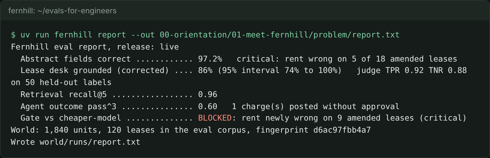

# Meet Fernhill

## The problem

Fernhill Homes runs three LLM systems on 120 leases and the ledger behind them. Before you measure anything, you need the world on your machine, the system of record seeded, and a clear picture of the finish line: the eval report card you will build, part by part.



## Your challenge

Set up, meet the world, run the finished system, and save its report card in this folder. No model key is needed: everything runs on recorded replies.

```bash
uv sync && uv run world reset
```

Expect: `World ready: 1,840 units in 31 buildings, 120 leases in the eval corpus (130 in all)`.

```bash
uv run world tour
```

Expect: `Fernhill Homes manages 1,840 homes and shops in 31 buildings for 60 owners.` and Dana's note.

```bash
uv run fernhill demo
```

Expect: `Fernhill demo: lease L008` and a `monthly_rent` row marked `WRONG`: the abstractor missed the amendment.

```bash
uv run fernhill report --out 00-orientation/01-meet-fernhill/problem/report.txt
```

Expect: `Fernhill eval report, release: live` and five lines, ending `Wrote 00-orientation/01-meet-fernhill/problem/report.txt`.

## Done when

- `report.txt` is in this folder, written by `uv run fernhill report`.
- It is the report for the live release and has all five report lines.
- The gate line says the cheaper model is `BLOCKED`.
- Its world line matches this repo's world.

```bash
bun run verify meet-fernhill
```

Expect: `Done. All 5 rules pass.` and a `Progress:` line.

## If you get stuck

| What you see                                         | Fix                                                                     |
| ---------------------------------------------------- | ----------------------------------------------------------------------- |
| `uv: command not found` or `bun: command not found`  | Install both, as the orientation README says, then open a new terminal. |
| `FAIL its world line matches the world in this repo` | Run `uv run world reset` and write the report again.                    |
| `No recorded reply for this prompt`                  | Leave `LLM_PROVIDER` unset or set to `replay` in `.env`.                |

## Words you will use

- **System of record**: the database the business trusts as the truth. At Fernhill it is `world/fernhill.db`.
- **Replay**: answering model calls from recorded replies, so the course runs with no key and gives the same result every time.
- **Report card**: the five numbers that say whether Fernhill's LLM systems can be trusted this release.
