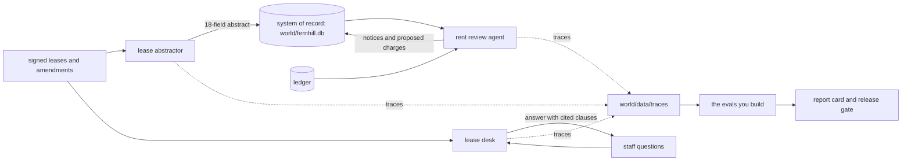
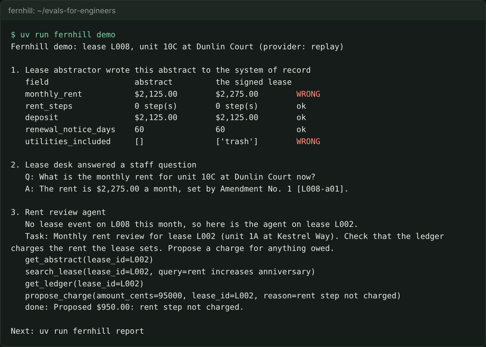

# Start here

You will set up the repo, meet Fernhill Homes, run the finished system and see the goal. It takes about 15 minutes and needs no model key.

## What you need

- [uv](https://docs.astral.sh/uv/) for Python. The course code, your work and the finished system are Python 3.12 or newer.
- [Bun](https://bun.sh) for the checks. `bun run verify <step-name>` checks your work on any step.
- Git, a terminal and a browser. A model key is optional: see "Run it live" below.

## The world

Fernhill Homes is a fictional residential property manager: 1,840 homes and shops in 31 buildings for 60 owners. Its lease administration team of four keeps the system of record right. Their lead, Dana Mensah, decides what "correct" means, and her labels are the truth in this course.



## Walkthrough

```bash
git clone https://github.com/learnwithparam/evals-for-engineers && cd evals-for-engineers
```

Expect: `Cloning into 'evals-for-engineers'...`

```bash
bun install && uv sync
```

Expect: both end with no errors. `uv sync` prints `Installed` and a package count.

```bash
uv run world reset
```

Expect: `World ready: 1,840 units in 31 buildings, 120 leases in the eval corpus (130 in all)`.

```bash
uv run models
```

Expect: `Provider: replay` and `Every role answers.`

```bash
uv run fernhill demo
```

Expect: `Fernhill demo: lease L008`, the abstract with a `monthly_rent` row marked `WRONG`, a lease desk answer and the agent's tool calls.

```bash
bun run verify meet-fernhill
```

Expect: five `FAIL` lines, each with a `Try next:` line. Every step starts failing. Now do the step in [01-meet-fernhill](01-meet-fernhill/problem/README.md).



## See the goal

The report card below is what the finished system prints. Each line is a part of this course. By the end you can produce every number on it with your own code, and defend each one.

| Report line | Built in |
|---|---|
| Abstract fields correct, rent on amended leases | Find the failures, Check with code |
| Lease desk grounded, corrected, with judge TPR and TNR | Judge what code cannot |
| Gate vs cheaper-model | Gate the change |
| (new failures from production) | Watch production |
| Retrieval recall@5, agent outcome pass^3 | Evaluate retrieval and the agent |

## Run it live

Replay is the default, so nothing here costs money. To call a real model, copy `.env.example` to `.env`, set `LLM_PROVIDER` to `anthropic`, `openrouter` or `openai`, and fill in that one key. Then `uv run models` makes one tiny call per role and prints pass or fail and the cost. The checks always run in replay mode.

When a command prints something you do not expect, look it up in [troubleshooting.md](troubleshooting.md).
