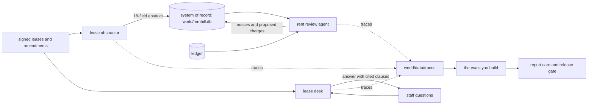

# Start here

In this part you set up the repo and meet Fernhill Homes. Then you run the finished system and see the goal. It takes about 15 minutes. You do not need a model key.

## What you need

- [uv](https://docs.astral.sh/uv/) for Python. The course code, your work and the finished system all use Python 3.12 or newer.
- [Bun](https://bun.sh) for the checks. `bun run verify <step-name>` checks your work on any step.
- Git, a terminal and a browser. A model key is optional: see "Run it live" below.

## The world

Fernhill Homes is a made-up company that manages rented property: 1,840 homes and shops in 31 buildings for 60 owners. A team of four people looks after the leases. They keep the system of record right: the database the business trusts as the truth. Their lead, Dana Mensah, decides what "correct" means. Her labels (her pass or fail verdicts) are the truth in this course.

Fernhill runs three LLM systems, shown in the picture below:

- The **lease abstractor** reads a signed lease and writes an abstract: 18 fields such as rent, deposit and renewal notice days.
- The **lease desk** answers staff questions about a lease and cites the clauses it used.
- The **rent review agent** compares the lease with the ledger (the list of charges) and proposes a charge when rent is missing.

Each run leaves a trace: a record of what went in and what came out. You build your evals from these traces.



## Walkthrough

```bash
git clone https://github.com/learnwithparam/evals-for-engineers && cd evals-for-engineers
```

Expect: `Cloning into 'evals-for-engineers'...`

```bash
bun install && uv sync
```

Expect: both end with no errors. `uv sync` prints `Installed` and a package count.

```bash
uv run world reset
```

Expect: `World ready: 1,840 units in 31 buildings, 120 leases in the eval corpus (130 in all)`.

```bash
uv run models
```

Expect: `Provider: replay` and `Every role answers.`

```bash
uv run fernhill demo
```

Expect: `Fernhill demo: lease L008`, the abstract with a `monthly_rent` row marked `WRONG`, a lease desk answer and the agent's tool calls.

```bash
bun run verify meet-fernhill
```

Expect: five `FAIL` lines, each with a `Try next:` line. Every step starts out failing, so this is normal. Now do the step in [01-meet-fernhill](01-meet-fernhill/problem/README.md).


## See the goal

The report card is what the finished system prints. Each line comes from one part of this course. By the end, your own code produces every number on it, and you can explain each one.

For example, this is the line the lease desk part builds, as `uv run fernhill report` prints it today:

```text
  Lease desk grounded (corrected) .... 86% (95% interval 74% to 100%)   judge TPR 0.92 TNR 0.88 on 50 held-out labels
```

It says that 86% of lease desk answers are grounded: the cited clause really supports them. A judge model graded the answers, and the 86% is already corrected for that judge's mistakes.

| Report line                                            | Built in                           |
| ------------------------------------------------------ | ---------------------------------- |
| Abstract fields correct, rent on amended leases        | Find the failures, Check with code |
| Lease desk grounded, corrected, with judge TPR and TNR | Judge what code cannot             |
| Gate vs cheaper-model                                  | Gate the change                    |
| (new failures from production)                         | Watch production                   |
| Retrieval recall@5, agent outcome pass^3               | Evaluate retrieval and the agent   |

## Run it live

Replay is the default. In replay mode, every model call gets a reply that was recorded earlier, so nothing here costs money. To call a real model, copy `.env.example` to `.env`. Set `LLM_PROVIDER` to `anthropic`, `openrouter` or `openai`, and fill in that one key. Then `uv run models` makes one tiny call per role and prints pass or fail and the cost. The checks always run in replay mode.

When a command prints something you do not expect, look up its first line in [troubleshooting.md](troubleshooting.md).
