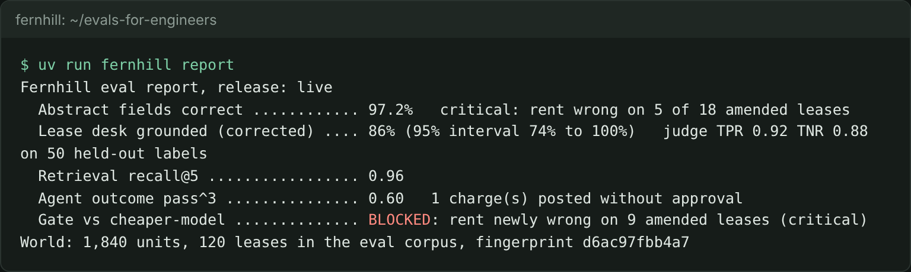
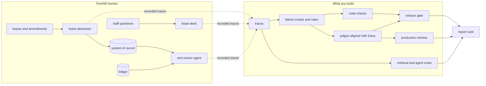

# Evals for Engineers

Turn an expert's judgment into an LLM judge you can prove, and a release gate that acts on it.

You work at Fernhill Homes, a property manager with three LLM systems: a lease abstractor, a lease desk and a rent review agent. You start where most teams are: reading ten outputs before a release. You finish with a report card whose every number you can defend, and a gate that blocks a cheaper model that an average would have shipped.

**Who it is for:** engineers who own an LLM feature or agent that people depend on. You can write Python and run tests. If you have never labelled data or measured a classifier, you will be fine: every step has a check and a sample answer. If you already build judges, the extensions cover bias correction, pass^k and failure maps.

## Run the finished system first

No model key needed. Install [uv](https://docs.astral.sh/uv/) and [Bun](https://bun.sh), then:

```bash
bun install && uv sync && uv run world reset
```

Expect: `World ready: 1,840 units in 31 buildings, 120 leases in the eval corpus (130 in all)`.

```bash
uv run fernhill report
```

Expect: `Fernhill eval report, release: live` and five lines, the last `Gate vs cheaper-model .............. BLOCKED: rent newly wrong on 9 amended leases (critical)`.



```bash
uv run fernhill gate --release cheaper-model --average-only
```

Expect: `Average gate on cheaper-model: PASS (field accuracy drops 1.3 points; the limit is 2.0)`. The average lets it through; the gate you build does not.

## The world and what you build



Dana Mensah, head of lease administration, is the expert. Her labels define "correct". The data is synthetic and generated from one seed, so every planted fault is known and the repo can be public.

## Parts

| Part                                                                                | You produce                                                        | Minutes |
| ----------------------------------------------------------------------------------- | ------------------------------------------------------------------ | ------- |
| [Start here](00-orientation/README.md)                                              | the world on your machine and the finished report card             | 15      |
| [Find the failures](parts/01-find-the-failures/README.md)                           | failure modes and rates from 40 traces you read yourself           | 75      |
| [Check with code](parts/02-check-with-code/README.md)                               | a golden set, field checks and a ledger cross-check                | 50      |
| [Judge what code cannot](parts/03-judge-what-code-cannot/README.md)                 | a judge with TPR and TNR on held-out labels, a corrected pass rate | 90      |
| [Gate the change](parts/04-gate-the-change/README.md)                               | a gate that blocks critical regressions and fails closed, in CI    | 55      |
| [Watch production](parts/05-watch-production/README.md)                             | a corrected rate per batch, an alert, new golden cases             | 40      |
| [Evaluate retrieval and the agent](parts/06-evaluate-retrieval-and-agent/README.md) | recall@k, an abstention judge, end-state agent grades              | 80      |

Each step: read `problem/README.md`, do the work in `problem/`, then run `bun run verify <step-name>`. It prints what passed, what failed and what to try next. `bun run verify part <part-name>` checks a whole part. The schedules for one day, four evenings or six sessions are in `schedules.toml`.

## Models

Every model call goes through `config/models.py`, by role: `fast`, `smart` and `judge`. `LLM_PROVIDER=replay` is the default and needs no key. To run live, copy `.env.example` to `.env`, set `LLM_PROVIDER` to `anthropic`, `openrouter` or `openai`, and add that one key. `uv run models` makes one tiny call per role and prints pass or fail and the cost.

## The project

Your own copy of this repo, with your failure modes, checks, judge, gate and CI workflow, and a `REPORT.md` with four numbers: the top failure mode and its rate, your judge's TPR and TNR on held-out labels, the corrected pass rate with its interval, and what your gate blocked. A reviewer can check each against the repo's own output.

## Read before you start

| Title                                                                                                                                                  | Author                       | Minutes | Why                                                                                                         |
| ------------------------------------------------------------------------------------------------------------------------------------------------------ | ---------------------------- | ------- | ----------------------------------------------------------------------------------------------------------- |
| [Demystifying evals for AI agents](https://www.anthropic.com/engineering/demystifying-evals-for-ai-agents)                                             | Anthropic                    | 25      | The words this course uses (task, trial, grader, pass@k, pass^k) and why a broken grader hides real results |
| [Error analysis for LLM applications](https://github.com/langfuse/langfuse-docs/blob/main/content/guides/cookbook/error-analysis-llm-applications.mdx) | Langfuse                     | 13      | Find the failures follows it step by step                                                                   |
| [validate-evaluator skill](https://github.com/ai-evals-course/evals-skills/blob/main/skills/validate-evaluator/SKILL.md)                               | Shreya Shankar, Hamel Husain | 8       | Why judges are measured by TPR and TNR, and kappa is kept for two people                                    |

When something goes wrong, see [troubleshooting](00-orientation/troubleshooting.md).
