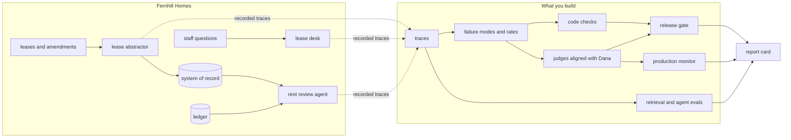

# Evals for Engineers

Turn an expert's judgment into an LLM judge you can prove, and a release gate that acts on it.

You work at Fernhill Homes, a company that manages rented homes and shops. It runs three LLM systems: a lease abstractor, a lease desk and a rent review agent. You start where most teams start: someone reads ten outputs before a release and says "looks fine". You finish with a report card, and you can defend every number on it. You also build a gate that blocks a cheaper model, even though its average score looks good enough to ship.

**Who it is for:** engineers who own an LLM feature or agent that people depend on. You can write Python and run tests. You do not need to know how to label data or measure a classifier: every step has a check and a sample answer. If you already build judges, the extensions cover bias correction, pass^k and failure maps.

## Run the finished system first

You do not need a model key. Install [uv](https://docs.astral.sh/uv/) and [Bun](https://bun.sh), then:

```bash
bun install && uv sync && uv run world reset
```

Expect: `World ready: 1,840 units in 31 buildings, 120 leases in the eval corpus (130 in all)`.

```bash
uv run fernhill report
```

Expect: `Fernhill eval report, release: live` and five report lines, the last `Gate vs cheaper-model .............. BLOCKED: rent newly wrong on 9 amended leases (critical)`. A last `World:` line names the copy of the world you run.


```bash
uv run fernhill gate --release cheaper-model --average-only
```

Expect: `Average gate on cheaper-model: PASS (field accuracy drops 1.3 points; the limit is 2.0)`. The average lets it through; the gate you build does not.

For example, run the gate you build on the same cheaper model: `uv run fernhill gate --release cheaper-model`. It prints `Gate on cheaper-model: BLOCKED`, with the reason `rent newly wrong on 9 amended leases (critical)`.

On average, the cheaper model is only 1.3 points worse. But it gets the rent wrong on 9 more leases that have an amendment. Those are the leases owners complain about. This course teaches you to see that kind of failure, count it and stop it.

## The world and what you build



Dana Mensah is the head of lease administration. She is the expert. Her labels define "correct" in this course. The data is synthetic: one fixed seed generates all of it. So every planted fault (a mistake put in on purpose) is known, and the repo can be public.

A few words you will meet in the table below:

- A **trace** is the record of one run of an LLM system: what went in, what the model did and what came out.
- A **label** is an expert's verdict on a trace, such as pass or fail.
- A **failure mode** is one kind of mistake that keeps coming back, with a name. For example, `amended-rent-missed`: the abstract keeps the old rent and ignores an amendment.
- A **golden set** is a fixed list of cases with known right answers. You test every release on it.
- A **judge** is a model that grades another model's output, for the questions code cannot check.
- **TPR** (true positive rate) is how often the judge passes what Dana passes. **TNR** (true negative rate) is how often it fails what Dana fails.
- A **gate** is a check that decides if a release may ship.
- A **trial** is one run of a case. **pass^k** means that all k trials of a case pass.
- **recall@k** is how often the right lease clause is in the top k search results.

## Parts

| Part                                                                                | You produce                                                        | Minutes |
| ----------------------------------------------------------------------------------- | ------------------------------------------------------------------ | ------- |
| [Start here](00-orientation/README.md)                                              | the world on your machine and the finished report card             | 15      |
| [Find the failures](parts/01-find-the-failures/README.md)                           | failure modes and rates from 40 traces you read yourself           | 75      |
| [Check with code](parts/02-check-with-code/README.md)                               | a golden set, field checks and a ledger cross-check                | 50      |
| [Judge what code cannot](parts/03-judge-what-code-cannot/README.md)                 | a judge with TPR and TNR on held-out labels, a corrected pass rate | 90      |
| [Gate the change](parts/04-gate-the-change/README.md)                               | a gate that blocks critical regressions and fails closed, in CI    | 55      |
| [Watch production](parts/05-watch-production/README.md)                             | a corrected rate per batch, an alert, new golden cases             | 40      |
| [Evaluate retrieval and the agent](parts/06-evaluate-retrieval-and-agent/README.md) | recall@k, an abstention judge, end-state agent grades              | 80      |

Each step works the same way. Read `problem/README.md`, do the work in `problem/`, then run `bun run verify <step-name>`. It prints what passed, what failed and what to try next. `bun run verify part <part-name>` checks a whole part at once. `schedules.toml` shows how to fit the course into one day, four evenings or six sessions.

## Models

Every model call goes through one file, `config/models.py`. It picks a model by role: `fast`, `smart` or `judge`. The default is `LLM_PROVIDER=replay`. Replay answers each call from a saved reply, so you need no key and get the same result every time. To call a real model, copy `.env.example` to `.env`. Set `LLM_PROVIDER` to `anthropic`, `openrouter` or `openai`, and add that one key. Then `uv run models` makes one tiny call per role and prints pass or fail and the cost.

## The project

At the end you have your own copy of this repo. It holds your failure modes, checks, judge, gate and CI workflow. It also holds a `REPORT.md` with four numbers:

1. the top failure mode and its rate;
2. your judge's TPR and TNR on held-out labels (labels the judge never saw while you built it);
3. the corrected pass rate with its interval;
4. what your gate blocked.

A reviewer can check each number against the repo's own output.

## Read before you start

| Title                                                                                                                                                  | Author                       | Minutes | Why                                                                                                         |
| ------------------------------------------------------------------------------------------------------------------------------------------------------ | ---------------------------- | ------- | ----------------------------------------------------------------------------------------------------------- |
| [Demystifying evals for AI agents](https://www.anthropic.com/engineering/demystifying-evals-for-ai-agents)                                             | Anthropic                    | 25      | The words this course uses (task, trial, grader, pass@k, pass^k) and why a broken grader hides real results |
| [Error analysis for LLM applications](https://github.com/langfuse/langfuse-docs/blob/main/content/guides/cookbook/error-analysis-llm-applications.mdx) | Langfuse                     | 13      | Find the failures follows it step by step                                                                   |
| [validate-evaluator skill](https://github.com/ai-evals-course/evals-skills/blob/main/skills/validate-evaluator/SKILL.md)                               | Shreya Shankar, Hamel Husain | 8       | Why judges are measured by TPR and TNR, and kappa is kept for two people                                    |

When something goes wrong, look up the message in [troubleshooting](00-orientation/troubleshooting.md).
