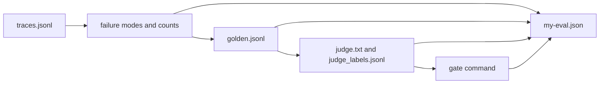

# Capstone: do it on your work

You have built every piece on Fernhill. Now run the same pieces on your own system. This folder gives you a template, a filled sample and a check.



## Your turn

1. Copy `capstone/template` to a folder of your own, outside the course. Call it `my-eval`.
2. Save your own traces in `traces.jsonl`. Each line has an `id`.
3. Write the cases a person approved in `golden.jsonl`.
4. Write your judge in `judge.txt`. In `judge_labels.jsonl`, add one line for each labelled answer: its `id`, what the `human` said and what the `judge` said, each `pass` or `fail`.
5. Fill in `my-eval.json`. Replace every `TODO`. The TPR and TNR must match what the labels file gives.
6. Run the check on your folder:

```bash
bun capstone/check.ts my-eval
```

Expect: `Done. All 9 rules pass.`

To see what good looks like, run it on the sample, then on the empty template:

```bash
bun capstone/check.ts capstone/sample
bun capstone/check.ts capstone/template
```

Expect: the sample passes, and the template fails.

## What the check proves

It reads only the folder you give it. It proves the shape: your files exist, the counts match the files, the failure modes point to real traces, and the judge rates come from your labels. It cannot tell if your numbers are wise. Show the file to a colleague and ask them to open one example trace.
