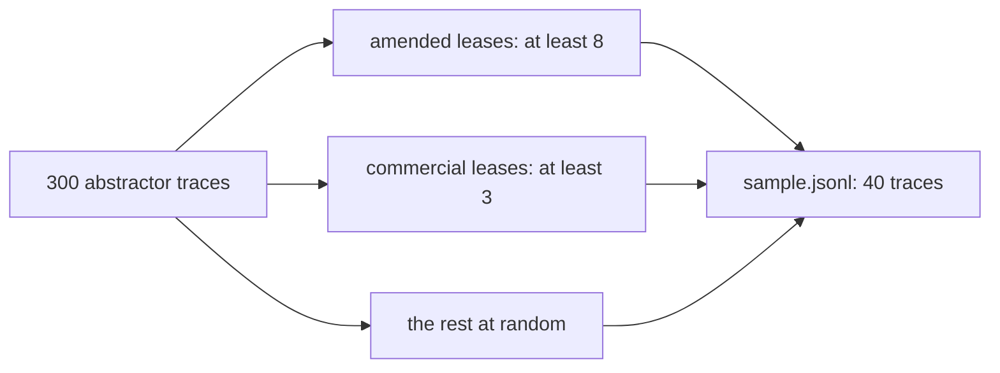

# Sample the traces

## The problem

The abstractor has written 300 lease abstracts into the system of record. Dana knows of two wrong rent letters, but nobody knows how many abstracts are wrong or in what way. Reading all 300 is too slow. Reading the first 40 is worse: they come from the same few leases, and shops and amended leases, where mistakes cost most, would barely show up.



## Your challenge

Finish `sample()` in `sample.py` so it picks 40 traces for review. Cover the risky kinds first: at least 8 traces of amended leases and at least 3 of commercial leases. Fill the rest at random. The same seed must always give the same 40, so a colleague can review the same set.

Each line of `world/data/traces/abstractor.jsonl` is one trace. The fields you need are `trace_id`, `lease_type` (`residential` or `commercial`) and `amendments` (a count).

```bash
uv run python sample.py --seed 7
```

Expect: `Wrote 40 traces to` followed by the path of `sample.jsonl`.

## Done when

- `sample.py --seed 7` writes 40 real trace ids, with no repeats.
- At least 8 come from amended leases and at least 3 from commercial leases.
- The same seed gives the same sample, and a different seed gives a different one.

```bash
bun run verify sample-the-traces
```

Expect: `Done. All 7 rules pass.` and a `Progress:` line.

## If you get stuck

| What you see | Fix |
|---|---|
| `FAIL sample.py --seed 7 runs and writes 40 traces` | Run the script yourself and read the error. `NotImplementedError` means `sample()` is still the starter. |
| `FAIL at least 3 traces of commercial leases` | Only 10 of the 120 leases are shops. A plain random draw often misses them, so pick them as their own group. |
| `FAIL the same seed gives the same sample` | Make one `random.Random(seed)` and use it for every pick. `random.sample()` on its own uses a new seed each run. |

The sample answer is in `../solution/sample.py`. Open it after you have tried.

## Words you will use

- **Trace**: the record of one run of a system: what went in, what came out, and each step between.
- **Stratified sample**: a sample that takes a set number from each group first, so small groups are not missed.
- **Seed**: a number that fixes what a random generator produces, so a run can be repeated exactly.
