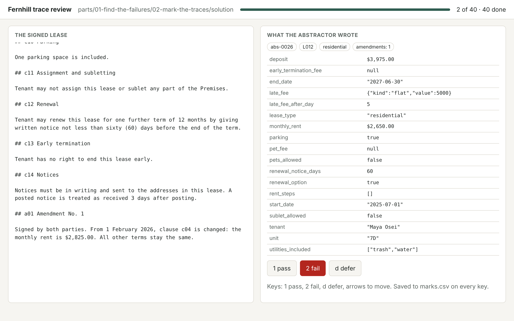

# Mark the traces

## The problem

You have 40 traces. Before anyone writes an eval, a person has to look at each one and say: is this abstract right? Skip this and every later number rests on a guess about what goes wrong. Teams that hand this first read to a model learn little, because they never see their own failures.



## Your challenge

Open each trace in the review app. Read the lease on the left, including any amendment at the bottom, and the abstract on the right. Press `1` if every field matches the signed lease and `2` if any field is wrong. Press `d` to come back to a trace later. The app saves `marks.csv` in this folder on every key.

```bash
uv run review mark-the-traces
```

Expect: `Review app for parts/01-find-the-failures/02-mark-the-traces/problem: http://127.0.0.1:8765`. Open that address in your browser.

You can also fill in `marks.csv` by hand: one row per trace, `trace_id,mark`, with `pass` or `fail`.

## Done when

- Every trace in `sample.jsonl` has one mark, `pass` or `fail`, and nothing is left on defer.
- Every trace with a planted fault is marked `fail`.
- Your marks agree with Dana's on at least 32 of the 40 traces.

```bash
bun run verify mark-the-traces
```

Expect: `Done. All 5 rules pass.` and a `Progress:` line.

## If you get stuck

| What you see | Fix |
|---|---|
| `FAIL every trace with a planted fault is marked fail` | Check rent against the amendment, rent steps against the rent increases clause, and renewal notice days against the renewal clause. |
| `FAIL your marks agree with Dana's on at least 32 of the 40 traces` | A trace fails when any one field is wrong. Check utilities, the late fee and the deposit too. |
| `Address already in use` | Another review app is running. Stop it with Ctrl+C, or add `--port 8766`. |

## Words you will use

- **Mark**: your pass or fail verdict on one trace, before you say why.
- **Planted fault**: a mistake built into the Fernhill world on purpose, so the checks know it is there.
- **Amendment**: a later signed change to a lease. It wins over the clause it changes.
