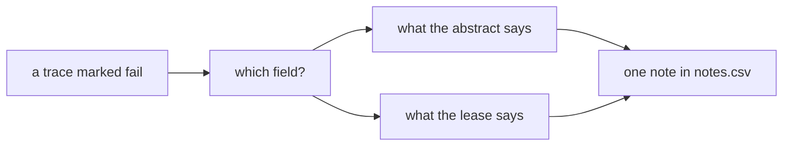

# Note the failures

## The problem

A fail mark says something went wrong, not what. Without a note, the 16 failed traces are 16 identical red rows, and the next step has nothing to group. A note that guesses the cause ("the prompt is too short") is worse: it sends the team to fix something before anyone knows what happened.



## Your challenge

For every trace you marked `fail`, write one note that describes what the abstract did. Name the field, what the abstract says, and what the lease says. Describe the behaviour, do not diagnose it. When two fields are wrong, start with the first thing that went wrong.

The review app shows only the failed traces in this step and saves `notes.csv` as you type.

```bash
uv run review note-the-failures
```

Expect: `Review app for parts/01-find-the-failures/03-note-the-failures/problem: http://127.0.0.1:8765`.

A good note: `Rent in the abstract is $2,650.00, the amount before the amendment; Amendment No. 1 sets it to $2,825.00.` A note that diagnoses: `The prompt should tell the model to read amendments.`

## Done when

- Every trace marked `fail` in `marks.csv` has a note in `notes.csv`.
- Every note has at least 5 words.
- No note names a fix or a cause: no `should`, `prompt`, `fix`, `instead`.
- Each note on a planted fault names the field: rent, the rent step, or the renewal notice days.

```bash
bun run verify note-the-failures
```

Expect: `Done. All 5 rules pass.` and a `Progress:` line.

## If you get stuck

| What you see | Fix |
|---|---|
| `FAIL no note names a fix or a cause` | Rewrite the note as what you saw: the field, the value written, the value in the lease. |
| `FAIL each note on a planted fault names the field that went wrong` | Use the field's own words: rent, rent step, renewal notice. |
| `FAIL every trace marked fail has a note` | Move through every trace in the app with the right arrow key; the counter shows how many are done. |

## Words you will use

- **Open coding**: writing a short free note on each failure, before you decide on any categories.
- **Describe, do not diagnose**: write what the system did, which you can see, not why, which you can only guess.
