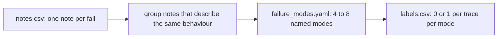

# Name the failure modes

## The problem

A failure mode is one named kind of mistake that you can count across traces. Sixteen notes are still sixteen separate stories. Dana cannot act on them, and you cannot count them. You need a short list of named failure modes. Define each one well enough that a colleague would put the same trace in the same mode. Generic names such as "hallucination" or "formatting" hide the one mistake that costs money.



## Your challenge

Read your notes and group the ones that describe the same behaviour. Write 4 to 8 modes in `failure_modes.yaml`. Give each one a name, a one-sentence definition and the trace ids that show it. Then fill `labels.csv`: one row per reviewed trace and one column per mode. Write `1` where the mode applies and `0` where it does not.

For example, traces `abs-0026`, `abs-0027` and `abs-0028` all have the same note:

```
Rent in the abstract is $2,650.00, the amount before the amendment; Amendment No. 1 sets it to $2,825.00.
```

They show one behaviour, so they go into one mode. Dana's list writes it like this:

```yaml
- name: amended-rent-missed
  definition: The abstract keeps the rent from the original lease and ignores a later amendment.
  examples: [abs-0026, abs-0027, abs-0028]
```

The name says which field went wrong and how. That is why it is not generic.

`labels.csv` starts like this:

```
trace_id,amended-rent-missed,rent-step-dropped
abs-0011,0,0
abs-0026,1,0
```

## Done when

- `failure_modes.yaml` lists 4 to 8 modes with names in lower-case-with-dashes, and no generic name.
- Each definition is one sentence of 25 words or fewer, and each example is a failed trace with a note.
- `labels.csv` has a row for all 40 traces and a 0 or 1 under every mode.
- Every failed trace has at least one mode and every passed trace has none.
- One mode covers every trace where the rent misses the amendment.

```bash
bun run verify name-the-failure-modes
```

Expect: `Done. All 9 rules pass.` and a `Progress:` line.

## If you get stuck

| What you see                                    | Fix                                                                                                |
| ----------------------------------------------- | -------------------------------------------------------------------------------------------------- |
| `FAIL failure_modes.yaml lists 4 to 8 modes`    | One mode per trace is too many. Merge notes that name the same field and the same kind of mistake. |
| `FAIL no mode has a generic name`               | Name the field and what happened to it, such as `deposit-includes-pet-deposit`.                    |
| `FAIL every failed trace has at least one mode` | A failed trace with no mode means you are missing a mode, or a definition is too narrow.           |

The sample answer, Dana's own list, is in `../solution/`. Compare after you have tried.

## Words you will use

- **Failure mode**: one named, defined kind of mistake that you can count across traces.
- **Axial coding**: grouping open notes into a small set of categories.
- **Label**: a 0 or 1 that says whether a failure mode applies to a trace.
