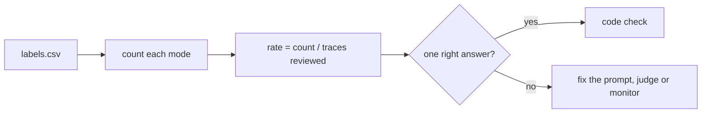

# Count the failures

## The problem

Dana asked one question: how often does this happen, and what kind of mistake is it? Your labels hold the answer, but nobody can read a 40 by 6 grid in a meeting. Each mode also needs a decision, because a mistake with one right answer, such as a rent amount, should be caught by code on every release, not by a person reading.



## Your challenge

Compute, from `labels.csv`, the count and rate of each failure mode and the mode that happens most. Give each mode one decision: `fix the prompt`, `code check`, `judge` or `monitor`. Write it all to `rates.json`. The starter `count.py` reads the labels for you.

```bash
uv run python count.py
```

Expect: `Wrote rates.json` and, once you finish it, the top mode with its count.

## Done when

- `rates.json` has `n`, `top_mode` and an entry per mode with `count`, `rate` and `decision`.
- Every count and rate matches `labels.csv`.
- `top_mode` is the mode with the highest count.
- Every mode has one of the four decisions, and the rent modes are `code check`.

```bash
bun run verify count-the-failures
```

Expect: `Done. All 6 rules pass.` and a `Progress:` line.

## If you get stuck

| What you see                                                          | Fix                                                                                                                     |
| --------------------------------------------------------------------- | ----------------------------------------------------------------------------------------------------------------------- |
| `FAIL every mode has a count and a rate that match labels.csv`        | Compute the numbers with code, not by eye. The rate divides by all 40 reviewed traces, not by the failures.             |
| `FAIL rent failures, which have one right answer, go to a code check` | A rent value in the lease is either matched or not. Comparing two numbers in code is cheaper and steadier than a judge. |

## Words you will use

- **Failure rate**: the share of reviewed traces that show a failure mode.
- **Code check**: a test in code that compares an output with a known right answer.
- **Judge**: a model that grades an output on one criterion when no code check can decide it.
