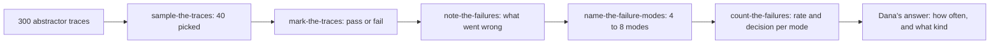

# Find the failures

## The problem

Dana Mensah, head of lease administration at Fernhill Homes, says owners got two wrong rent letters last month. Nobody can say whether that is 2 in 2,000 abstracts or 2 in 20, or what kinds of mistakes the abstractor makes. Writing evals now would mean guessing which failures to test for.

## Why it matters

A number about an LLM system is only as good as the person who looked at the outputs first. Anthropic's engineering team reports that a model scored 42% on a public agent benchmark until they fixed grading bugs and unclear task specs, after which it scored 95% ([Demystifying evals for AI agents](https://www.anthropic.com/engineering/demystifying-evals-for-ai-agents), Anthropic). The same post advises starting with "20-50 simple tasks drawn from real failures". Langfuse's error analysis guide gives the same order: review the first 30 to 50 traces yourself, describe behaviour without diagnosing it, then group the notes into named categories ([Error analysis for LLM applications](https://github.com/langfuse/langfuse-docs/blob/main/content/guides/cookbook/error-analysis-llm-applications.mdx), Langfuse).

This part needs no model key. Everything runs on recorded traces.



## Steps

| Step | Minutes | You produce | The check reads |
|---|---|---|---|
| `sample-the-traces` | 10 | `sample.py` that picks 40 traces | three runs of your sampler, against the trace file |
| `mark-the-traces` | 15 | `marks.csv`: pass or fail per trace | your marks, the planted faults, Dana's labels |
| `note-the-failures` | 20 | `notes.csv`: one note per fail | your notes, the planted faults |
| `name-the-failure-modes` | 20 | `failure_modes.yaml` and `labels.csv` | your modes, labels, notes and marks |
| `count-the-failures` | 10 | `rates.json`: rate and decision per mode | your rates, recomputed from your labels |

Each step starts from the sample answer of the step before it, so you can start at any step.

## Walkthrough

Work in each step's `problem/` folder. From the repo root:

```bash
cd parts/01-find-the-failures/01-sample-the-traces/problem && uv run python sample.py --seed 7 && cd -
```

Expect: `Wrote 40 traces to` and the path of `sample.jsonl`, once `sample()` is written.

```bash
bun run verify sample-the-traces
```

Expect: `Done. All 7 rules pass.`

```bash
uv run review mark-the-traces
```

Expect: `Review app for parts/01-find-the-failures/02-mark-the-traces/problem: http://127.0.0.1:8765`. Mark all 40 traces, then stop the app with Ctrl+C.

```bash
bun run verify mark-the-traces
```

Expect: `Done. All 5 rules pass.`

```bash
uv run review note-the-failures
```

Expect: `Review app for parts/01-find-the-failures/03-note-the-failures/problem: http://127.0.0.1:8765`. Write a note on every failed trace.

```bash
bun run verify note-the-failures
```

Expect: `Done. All 5 rules pass.`

Write `failure_modes.yaml` and `labels.csv` in `04-name-the-failure-modes/problem/`, then:

```bash
bun run verify name-the-failure-modes
```

Expect: `Done. All 9 rules pass.`

```bash
cd parts/01-find-the-failures/05-count-the-failures/problem && uv run python count.py && cd -
```

Expect: `Wrote rates.json`.

```bash
bun run verify part find-the-failures
```

Expect: `Part find-the-failures is done: 5/5 steps pass.`

## What you can show

`rates.json` answers Dana's question with numbers: the top failure mode, its rate, and which modes move to a code check in the next part, Check with code.

## Extension

Run your sampler with `--n 100`, review the extra traces, and plot how many new modes each block of 10 traces adds. Langfuse's rule of thumb is to stop when the last 20 traces added no new category.
