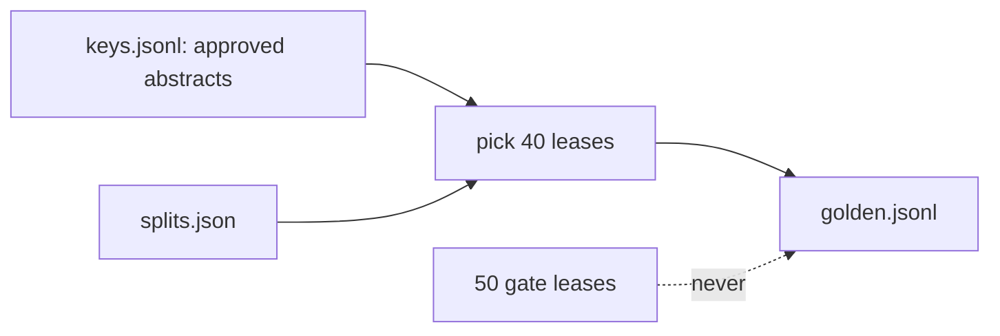

# Build the golden set

## The problem

To check the abstractor in code, you need the right answer for each lease. A golden set is a list of cases where a person has approved the right answer. Here, each case is one lease and the abstract that Dana Mensah approved for it.

Two mistakes make a golden set useless. The first is to fill it from the system you are testing: then every wrong value looks right. The second is to reuse the leases that will judge a release later: then a release can be tuned to those leases.



## Your challenge

Work in this step's `problem/` folder. From the repo root, go there first with `cd parts/02-check-with-code/01-build-the-golden-set/problem`.

Finish `golden_records()` in `build_golden.py`. It writes `golden.jsonl`: one line per lease, with three fields.

- `lease_id`: the lease, such as `L041`.
- `abstract`: the approved abstract from `world/data/keys.jsonl`.
- `critical_fields`: the fields where one mistake blocks a release.

Pick 40 leases. Take at least 10 amended leases and at least 3 commercial ones. Leave out the 50 leases in `splits["gate"]`. The next part, Gate the change, tests releases on those.

```bash
uv run python build_golden.py
```

Expect: `Wrote 40 approved abstracts to` and the path of `golden.jsonl`.

For example, lease L041 says its rent rises by 4% on each anniversary. Its approved abstract in `keys.jsonl` has this rent step:

```json
"rent_steps": [{"effective": "2026-07-01", "monthly_rent": 171600}]
```

The abstract in `world/data/system_of_record.jsonl` has `"rent_steps": []`. The abstractor dropped the step. If you copied the system of record, your golden set would call that empty list correct. In the sample answer, 13 of the 40 golden leases differ from the system of record.

Money is in cents, so `171600` is $1,716.00. Cents are whole numbers, so two amounts compare exactly.

## Done when

- `golden.jsonl` has 40 records, each for a different real lease.
- No lease is in the gate set.
- At least 10 leases are amended and at least 3 are commercial.
- Every abstract matches the approved one in `keys.jsonl`.
- Every `critical_fields` list holds `monthly_rent` and `renewal_notice_days`.

```bash
bun run verify build-the-golden-set
```

Expect: `Done. All 7 rules pass.` and a `Progress:` line.

## If you get stuck

| What you see                                                   | Fix                                                                                       |
| -------------------------------------------------------------- | ----------------------------------------------------------------------------------------- |
| `FAIL no lease comes from the gate set`                        | The first 40 leases include gate leases such as L001. Use the list in `splits["golden"]`. |
| `FAIL every abstract is the approved one from the answer keys` | You copied what the abstractor wrote. Take each abstract from `keys.jsonl` instead.       |
| `FAIL critical_fields names real fields, ...`                  | Spell the field names as the abstract does, such as `monthly_rent`, not `rent`.           |

The sample answer is in `../solution/build_golden.py`. Open it after you have tried.

## Words you will use

- **Golden set**: cases where a person approved the right answer, kept to test a system again and again.
- **Critical field**: a field where one wrong value costs money or a deadline, so it blocks a release.
- **Answer key**: the right abstract for a lease, written from the signed lease.
