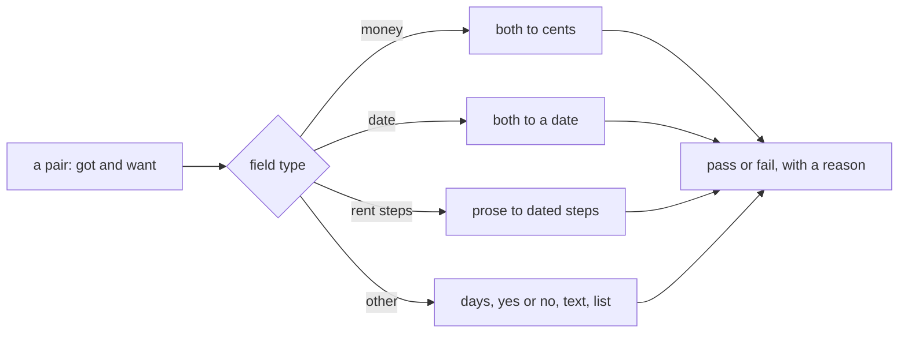
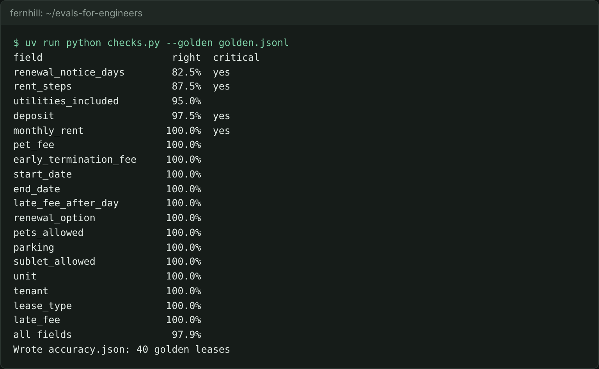

# Write field checks

## The problem

You have 40 approved abstracts. Now you need code that says if one field is right. It sounds like `got == want`. It is not.

The same rent can be written as `282500` (cents), `"$2,825.00"` or `"2825"`. The same date can be `2026-03-01` or `"1st day of March, 2026"`. A rent step can be a table row, or a sentence such as "the rent shall increase by 4% on each anniversary". A check that compares raw text calls these wrong.



## Your challenge

First, from the repo root: `cd parts/02-check-with-code/02-write-field-checks/problem`.

Finish the checks in `checks.py`. Each one takes `got` and `want` and returns two things: `True` or `False`, and a reason a person can read.

- `check_money`, `check_date`, `check_days`, `check_yes_no` and `check_text`.
- `expand_prose_steps`: turn a rent step sentence into one dated step per anniversary inside the term.

`to_cents()` and `to_date()` are ready to use, so you can focus on the checks.

For example, lease L002 starts on 2025-01-01, ends on 2026-12-31, and starts at $2,375.00. Its rent step is written in prose: "increase by 4% on each anniversary". There is one anniversary inside the term, so `expand_prose_steps` returns this:

```json
[{ "effective": "2026-01-01", "monthly_rent": 247000 }]
```

That is 237500 times 1.04, in cents.

Then score the live abstractor:

```bash
uv run python checks.py --golden golden.jsonl
```

Expect: a table of fields from worst to best, ending with `all fields                 97.9%` and `Wrote accuracy.json: 40 golden leases`.



One number, 97.9%, hides the story. Renewal notice days are right on only 82.5% of the golden leases, and rent steps on 87.5%. Both are critical fields.

## Done when

- `checks.py --pairs` answers every known pair once, with `pass` or `fail` and a reason.
- Zero wrong verdicts on money and on dates.
- Day counts, yes or no, names and lists are right too.
- Prose rent steps are expanded before they are compared.
- Three runs give the same verdicts.
- `--golden` writes `accuracy.json` within half a point of the world's own field checks.

```bash
bun run verify write-field-checks
```

Expect: `Done. All 8 rules pass.` and a `Progress:` line.

## If you get stuck

| What you see                                           | Fix                                                                                                        |
| ------------------------------------------------------ | ---------------------------------------------------------------------------------------------------------- |
| `FAIL zero wrong verdicts on money`                    | Compare `to_cents(got)` with `to_cents(want)`. Never compare dollars as floats: `0.30 * 100` is not 30.    |
| `FAIL zero wrong verdicts on dates`                    | Compare `to_date(got)` with `to_date(want)`, never the two strings.                                        |
| `FAIL prose rent steps are expanded before comparison` | Read the percent, then add a step on each anniversary up to the end date. Round each new rent to the cent. |

The verifier sends about 60 known pairs you do not see. Test your own first with `--pairs`. Each line looks like `{"id": "a", "field": "monthly_rent", "got": "$2,825.00", "want": 282500}`.

## Words you will use

- **Field check**: code that compares one field of an output with its approved value.
- **Normalise**: turn two ways of writing the same value into one form, so they compare equal.
- **Known pair**: a test case where you already know if the check should say pass or fail.
