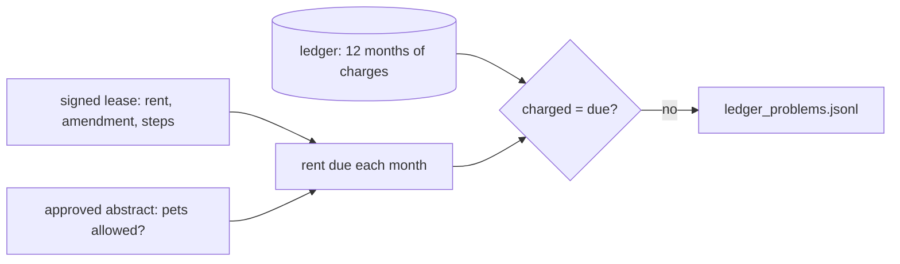

# Check the ledger

## The problem

A wrong abstract does not stay in one table. The rent in the abstract becomes the rent in the ledger, the list of every charge and payment. So a dropped rent step becomes rent that nobody charges, month after month.

Some ledger mistakes do not come from the abstractor at all. Someone may charge a pet fee on a lease that bans pets. Both mistakes have one right answer in the signed lease. Code can find them.



## Your challenge

First, from the repo root: `cd parts/02-check-with-code/03-check-the-ledger/problem`.

Finish two functions in `ledger_check.py`.

- `rent_due()`: the rent the signed lease sets for one month. Start from the original rent. An amendment changes it from its own effective month. Each rent step changes it from its date.
- `problems_for_lease()`: compare each month's charges with the lease. Flag rent that differs, and any pet fee on a lease that bans pets.

Take the truth from the signed lease: `leases.jsonl` for the original rent and the amendment, and `keys.jsonl` for the approved steps and pet rule. Do not take it from `system_of_record.jsonl`. That file holds the abstractor's output, which you are testing.

For example, lease L002 says the rent rises by 4% on 2026-01-01, from $2,375.00 to $2,470.00. But the ledger row for that month says:

```json
{
  "amount_cents": 237500,
  "kind": "rent",
  "lease_id": "L002",
  "month": "2026-01",
  "note": "monthly rent"
}
```

So your check writes this problem, and one more for each later month:

```json
{
  "charged": 237500,
  "lease_id": "L002",
  "lease_says": 247000,
  "month": "2026-01",
  "problem": "rent_not_as_lease"
}
```

```bash
uv run python ledger_check.py
```

Expect: `Found 81 problem months on 11 leases:`, then one line per lease, such as `L002  rent_not_as_lease`.

Six leases never got their rent step charged. Five pay a pet fee where pets are banned. Every other lease is clean.

## Done when

- `ledger_check.py` runs and writes `ledger_problems.jsonl`.
- Every problem names the lease, the month, the kind, the amount charged and what the lease says.
- It finds every lease whose rent step was never charged.
- It finds every lease charged a pet fee where pets are banned.
- It raises no alarm on a clean lease.

```bash
bun run verify check-the-ledger
```

Expect: `Done. All 5 rules pass.` and a `Progress:` line.

## If you get stuck

| What you see                                               | Fix                                                                                                            |
| ---------------------------------------------------------- | -------------------------------------------------------------------------------------------------------------- |
| `FAIL no false alarm on a clean lease`                     | You used the amended rent for every month. Before the amendment's effective month, the original rent is right. |
| `FAIL finds every lease whose rent step was never charged` | Read the steps from `keys.jsonl`. The system of record dropped them, so it agrees with the wrong ledger.       |
| `FAIL ledger_check.py runs and writes its problems`        | Run the script and read the error. `NotImplementedError` means a function is still the starter.                |

The sample answer is in `../solution/ledger_check.py`. Open it after you have tried.

## Words you will use

- **Ledger**: the list of every charge, payment and credit on a lease, one row per amount.
- **Cross-check**: comparing two systems that should agree, to find where one of them is wrong.
- **False alarm**: a problem your check reports on a lease that has no problem.
