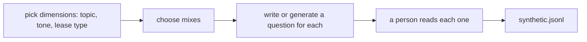

# Generate synthetic cases

## The problem

Real questions are few at the start. Ask a model for "fifty questions" and you get fifty copies of the same polite one. A set built that way tests one kind of tenant and misses the rushed, the vague and the commercial ones. So you pick the dimensions first, then make one case for each mix, and a person reads every case before it is kept.



## Your challenge

First, from the repo root: `cd parts/02-check-with-code/04-generate-synthetic-cases/problem`.

`seed_questions.jsonl` holds three real questions. Write at least 12 new ones in `synthetic.jsonl`, one JSON object per line. You can write them yourself or ask a model to write each from its dimensions. Then read each one.

Each case has these fields:

- `id`: a new id, such as `syn-01`.
- `source`: always `synthetic`, so nobody mistakes it for a real trace.
- `topic`: `late`, `pets`, `renewal` or `rent`.
- `tone`: `formal`, `rushed` or `vague`.
- `lease_type`: `residential` or `commercial`.
- `question`: the question a tenant or staff member would ask.
- `reviewed`: `true`, once you have read it and it makes sense.

For example, a rushed tenant on a commercial lease asks about the late fee:

```json
{
  "id": "syn-02",
  "source": "synthetic",
  "topic": "late",
  "tone": "rushed",
  "lease_type": "commercial",
  "question": "late fee on the shop unit? when does it kick in",
  "reviewed": true
}
```

Use every topic, every tone and both lease types. Change two dimensions at once for at least 8 different mixes. Do not copy a seed or a staff question from `world/data/questions.jsonl`.

## Done when

- At least 12 cases, each tagged synthetic and reviewed, each with its own id.
- Every case uses a topic, a tone and a lease type from the lists.
- Every value in each list is used at least once, across at least 8 mixes.
- Every question is new and has no repeat.

```bash
bun run verify generate-synthetic-cases
```

Expect: `Done. All 6 rules pass.` and a `Progress:` line.

## If you get stuck

| What you see                                            | Fix                                                           |
| ------------------------------------------------------- | ------------------------------------------------------------- |
| `FAIL every topic, tone and lease type is used...`      | One value is missing. Add a case for it.                      |
| `FAIL the cases cover at least 8 different ... mixes`   | Many cases share one mix. Change the tone and the lease type. |
| `FAIL every question is new, with at least 5 words ...` | Rewrite the short or copied ones in your own words.           |

The sample answer is in `../solution/synthetic.jsonl`. Open it after you have tried.

## Words you will use

- **Synthetic case**: a test case made up on purpose, not taken from real traffic.
- **Dimension**: one way cases can differ, such as tone or topic.
- **Mix**: one choice from each dimension, such as a rushed tenant on a commercial lease.
