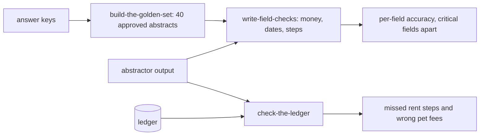

# Check with code

## The problem

Find the failures showed that the abstractor misses amendments and drops rent steps. Both have one right answer in the signed lease. Paying a model to judge them would be slower, cost more and be less steady than comparing two values. The same missed rent step also reaches the ledger: rent that the lease sets but nobody charges.

## Why it matters

Anthropic's engineering team advises that "20-50 simple tasks drawn from real failures is a great start" for a first eval set, and lists code-based graders as fast, cheap and reproducible where an output can be checked exactly ([Demystifying evals for AI agents](https://www.anthropic.com/engineering/demystifying-evals-for-ai-agents), Anthropic). A golden set of 40 approved abstracts, checked field by field in code, is that start for Fernhill.

## Steps

| Step | Minutes | You produce | The check reads |
|---|---|---|---|
| `build-the-golden-set` | 15 | `golden.jsonl`: 40 approved abstracts with a `critical_fields` list | the file, against `world/data/keys.jsonl` and `splits.json` (no gate lease) |
| `write-field-checks` | 20 | `checks.py`: one check per field type, with a pass or fail and a reason | a hidden table of known pass and fail pairs run through your checks, three runs |
| `check-the-ledger` | 15 | `ledger_check.py`: lease rent schedule against twelve months of charges | its output, against planted faults 4 and 6 and the clean leases |

## Walkthrough

TODO(part session): one command per step, each followed by its Expect: line.

## What you can show

A per-field accuracy table where rent on amended leases is its own blocking line, and a list of leases whose ledger never charged a rent step.
