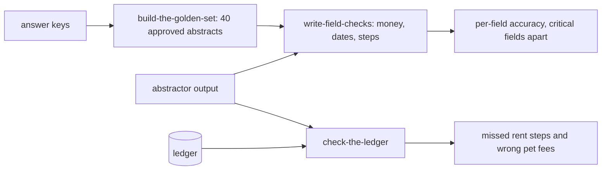

# Check with code

## The problem

In Find the failures, you saw two common mistakes. The abstractor misses amendments, and it drops rent steps. A rent step is a rent rise that the lease plans for a later date. Both mistakes have one right answer in the signed lease. You could pay a model to judge them, but it would be slower, cost more and give less steady results. Comparing two values in code is enough.

For example, the answer key for lease L008 in `world/data/keys.jsonl` says `"monthly_rent": 227500` (in cents). The live abstractor wrote `"monthly_rent": 212500`, the rent from before Amendment No. 1. One line of code can see that these two numbers differ.

The same missed rent step also reaches the ledger, the list of charges. For example, lease L002 says the rent rises by 4% on each anniversary, so it is $2,470.00 from January 2026. But the ledger still charges `237500` cents ($2,375.00) in 2026-10. That is rent the lease sets but nobody charges.

## Why it matters

Anthropic's engineering team gives advice for a first eval set: "20-50 simple tasks drawn from real failures is a great start". It also lists code-based graders as fast, cheap and reproducible, where an output can be checked exactly. The source is [Demystifying evals for AI agents](https://www.anthropic.com/engineering/demystifying-evals-for-ai-agents), from Anthropic.

For Fernhill, that start is a golden set: 40 abstracts that Dana has approved as correct. Your code checks the abstractor's output against them, field by field.

## Steps

| Step                   | Minutes | You produce                                                             | The check reads                                                                 |
| ---------------------- | ------- | ----------------------------------------------------------------------- | ------------------------------------------------------------------------------- |
| `build-the-golden-set` | 15      | `golden.jsonl`: 40 approved abstracts with a `critical_fields` list     | the file, against `world/data/keys.jsonl` and `splits.json` (no gate lease)     |
| `write-field-checks`   | 20      | `checks.py`: one check per field type, with a pass or fail and a reason | a hidden table of known pass and fail pairs run through your checks, three runs |
| `check-the-ledger`     | 15      | `ledger_check.py`: lease rent schedule against twelve months of charges | its output, against planted faults 4 and 6 and the clean leases                 |

## Walkthrough

TODO(part session): one command per step, each followed by its Expect: line.

## What you can show

You can show a table of accuracy for each field. In it, rent on amended leases has its own line, and a failure there blocks a release. You can also show a list of leases whose ledger never charged a rent step, such as L002.
