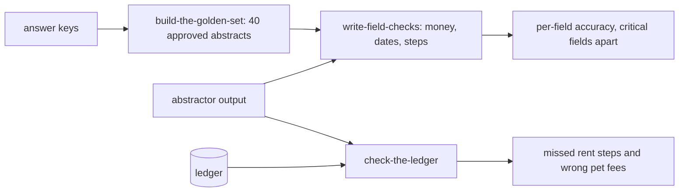

# Check with code

## The problem

In Find the failures, you saw two common mistakes. The abstractor misses amendments, and it drops rent steps. A rent step is a rent rise that the lease plans for a later date. Both mistakes have one right answer in the signed lease. You could pay a model to judge them, but it would be slower, cost more and give less steady results. Comparing two values in code is enough.

For example, the answer key for lease L008 in `world/data/keys.jsonl` says `"monthly_rent": 227500` (in cents). The live abstractor wrote `"monthly_rent": 212500`, the rent from before Amendment No. 1. One line of code can see that these two numbers differ.

The same missed rent step also reaches the ledger, the list of charges. For example, lease L002 says the rent rises by 4% on each anniversary, so it is $2,470.00 from January 2026. But the ledger still charges `237500` cents ($2,375.00) in 2026-10. That is rent the lease sets but nobody charges.

## Why it matters

Anthropic's engineering team gives advice for a first eval set: "20-50 simple tasks drawn from real failures is a great start". It also lists code-based graders as fast, cheap and reproducible, where an output can be checked exactly. The source is [Demystifying evals for AI agents](https://www.anthropic.com/engineering/demystifying-evals-for-ai-agents), from Anthropic.

For Fernhill, that start is a golden set: 40 abstracts that Dana has approved as correct. Your code checks the abstractor's output against them, field by field.



## Steps

| Step                       | Minutes | You produce                                                               | The check reads                                                                 |
| -------------------------- | ------- | ------------------------------------------------------------------------- | ------------------------------------------------------------------------------- |
| `build-the-golden-set`     | 15      | `golden.jsonl`: 40 approved abstracts with a `critical_fields` list       | the file, against `world/data/keys.jsonl` and `splits.json` (no gate lease)     |
| `write-field-checks`       | 20      | `checks.py`: one check per field type, with a pass or fail and a reason   | a hidden table of known pass and fail pairs run through your checks, three runs |
| `check-the-ledger`         | 15      | `ledger_check.py`: lease rent schedule against twelve months of charges   | its output, against planted faults 4 and 6 and the clean leases                 |
| `generate-synthetic-cases` | 15      | `synthetic.jsonl`: 12 or more new cases across topic, tone and lease type | the dimensions are all covered and no question is copied                        |

## Walkthrough

Work in each step's `problem/` folder. Each step starts from the sample answer of the step before it, so you can start at any step. From the repo root:

```bash
cd parts/02-check-with-code/01-build-the-golden-set/problem && uv run python build_golden.py && cd -
```

Expect: `Wrote 40 approved abstracts to` and the path of `golden.jsonl`, once `golden_records()` is written.

```bash
bun run verify build-the-golden-set
```

Expect: `Done. All 7 rules pass.`

```bash
cd parts/02-check-with-code/02-write-field-checks/problem && uv run python checks.py --golden golden.jsonl && cd -
```

Expect: a table of fields from worst to best, starting with `renewal_notice_days        82.5%  yes` and ending with `Wrote accuracy.json: 40 golden leases`.

```bash
bun run verify write-field-checks
```

Expect: `Done. All 8 rules pass.`

```bash
cd parts/02-check-with-code/03-check-the-ledger/problem && uv run python ledger_check.py && cd -
```

Expect: `Found 81 problem months on 11 leases:` and one line per lease.

```bash
bun run verify check-the-ledger
```

Expect: `Done. All 5 rules pass.`

```bash
bun run verify generate-synthetic-cases
```

Expect: `Done. All 6 rules pass.`

```bash
bun run verify part check-with-code
```

Expect:

```
Part check-with-code:
  PASS   build-the-golden-set  (7/7 rules)
  PASS   write-field-checks  (8/8 rules)
  PASS   check-the-ledger  (5/5 rules)
Part check-with-code is done: 3/3 steps pass.
```

## FINISHED

You now have three things you can run on every release:

- `golden.jsonl`: 40 abstracts that Dana approved, kept apart from the gate leases.
- `checks.py`: one check per field type. It scores the abstractor field by field, with the critical fields marked.
- `ledger_check.py`: it finds the six leases whose rent step was never charged, and the five pet fees charged where pets are banned.

For example, the live abstractor gets 97.9% of all fields right on the golden set. But it gets renewal notice days right on only 82.5% of leases. That is the number to bring to Dana, not the average.

Code cannot answer every question. "Is this lease desk answer supported by the clause it cites?" has no single value to compare. The next part, Judge what code cannot, builds a model judge for it and measures how well it agrees with Dana.

## Assignment

Add one field check of your own to `checks.py`, for a failure you saw in Find the failures. Then show it on the golden set.

Hand in, in your repo:

- `checks.py` with the new check and three known pairs for it in `my_pairs.jsonl`: two that must pass and one that must fail.
- A short `CHECKS.md`: the failure the check catches, and its accuracy on the golden set.

| Question                                                                                         | Yes or no |
| ------------------------------------------------------------------------------------------------ | --------- |
| Does `bun run verify part check-with-code` pass?                                                 | yes / no  |
| Does `uv run python checks.py --pairs my_pairs.jsonl` give the right verdict on all three pairs? | yes / no  |
| Does every money comparison use whole cents, never floats of dollars?                            | yes / no  |
| Does `CHECKS.md` name the failure mode from your `failure_modes.yaml`?                           | yes / no  |
| Does the accuracy in `CHECKS.md` match what `checks.py --golden` prints?                         | yes / no  |

Extension: write a property test with Hypothesis that writes the same date in ten formats. Show that `check_date` never changes its verdict.

## What you can show

You can show a table of accuracy for each field. In it, rent on amended leases has its own line, and a failure there blocks a release. You can also show a list of leases whose ledger never charged a rent step, such as L002.
