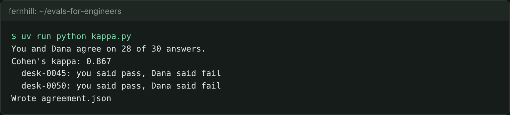

# Label the answers

## The problem

The lease desk answers staff questions and cites the lease clauses it used. An answer is grounded when the cited clauses say everything the answer says. Dana can tell a grounded answer at a glance. Before you ask a model to do her job, you need to know how hard the job is. Two careful people do not always agree. So first, you label some answers yourself and compare your labels with Dana's.



## Your challenge

Read the 30 answers in `answers.jsonl`. Each line has the staff question, the answer, and the text of every clause it cites. For each answer, decide `pass` (the clauses support every claim) or `fail` (they do not). Write one row per answer in `labels.csv`: `trace_id,label,critique`. The critique is one sentence that says why.

Then finish `cohens_kappa()` in `kappa.py` and run it:

```bash
uv run python kappa.py
```

Expect: `You and Dana agree on` with a count of 30, a `Cohen's kappa:` line, and `Wrote agreement.json`.

For example, here is the answer for trace `desk-0001` and the clause it cites:

```
Answer: Exactly 30 days' written notice is needed [L100-c12].
L100-c12: Tenant may renew this lease for one further term of 12 months by giving
written notice not less than thirty (30) days before the end of the term.
```

The clause says "not less than", and the answer says "exactly". So the row is `desk-0001,fail,The clause says not less than 30 days but the answer says exactly 30 days.`

Cohen's kappa counts how often you and Dana agree, minus the agreement that chance alone would give. A kappa of 1 means you always agree. A kappa of 0 means you agree no more than coin flips would. Any value passes this step. The point is to see where two people differ.

The sample labels agree with Dana on 28 of 30 answers, a kappa of 0.867. They differ on `desk-0045` and `desk-0050`. Each one quotes clause c04 word for word, but an amendment has changed that rent. Dana fails an answer that cites a clause an amendment replaced. Her rule only became clear once two people disagreed. Your judge prompt will need the same rule.

## Done when

- `labels.csv` has all 30 answers, each `pass` or `fail`, each with a critique of 5 words or more.
- `agreement.json` holds the kappa that your labels and Dana's really give.

```bash
bun run verify label-the-answers
```

Expect: `Done. All 5 rules pass.` and a `Progress:` line.

## If you get stuck

| What you see                                                      | Fix                                                                                               |
| ----------------------------------------------------------------- | ------------------------------------------------------------------------------------------------- |
| `NotImplementedError: cohens_kappa() is still the starter`        | Finish `cohens_kappa()`. The TODO lines give the three sums.                                      |
| `FAIL every label has a critique of 5 words or more`              | Say what differs, such as "the answer says exactly, the clause says not less than".               |
| `FAIL the kappa in agreement.json matches your labels and Dana's` | Run `kappa.py` again after your last label. Do not type the number into `agreement.json` by hand. |

## Words you will use

- **Grounded**: every claim in the answer is stated in the clauses it cites.
- **Label**: a person's pass or fail on one answer.
- **Cohen's kappa**: how much two people agree, beyond what chance gives. Use it only between two people.
