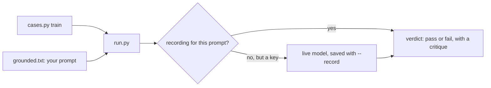

# Write the judge

## The problem

Dana cannot label every lease desk answer. A judge is a model that grades another model's output. A good judge grades one thing, gives only pass or fail, and says why first. Nobody can say what a score of 3 out of 5 means.



## Your challenge

Write the judge prompt in the plain text file `grounded.txt`, in four parts:

1. What it grades: one lease desk answer, on one criterion, grounded.
2. When an answer passes, and when it fails.
3. A few examples, taken only from the 20 train answers. These are optional.
4. The reply format: a one-sentence critique first, then the verdict, as JSON.

Then finish `read_verdict()` in `run.py`. It turns the model's reply into `{"verdict": "pass", "critique": "..."}`. The verdict must be exactly `pass` or `fail`, in lower case.

```bash
uv run python cases.py train | uv run python run.py
```

Expect: 20 lines, each like `{"id": "desk-0009", "verdict": "fail", "critique": "..."}`.

For example, the line for trace `desk-0009` comes out as:

```
{"id": "desk-0009", "verdict": "fail", "critique": "The answer drops the limit 'not less than' that the renewal clause states."}
```

**Without a key.** Replay answers only prompts that were recorded. It knows Dana's finished prompt in `../solution/grounded.txt`. If you have no key, write your own draft first, then compare it with that one and use it.

**With a key.** Set `LLM_PROVIDER` and one key in `.env`, then add `--record`. Each live reply is saved in `recorded.jsonl`, so the checks can replay your own prompt later with no key:

```bash
uv run python cases.py train | uv run python run.py --record
```

Expect: the same 20 lines, and a new `recorded.jsonl` in this folder.

Keep the dev and test answers out of your prompt. The check scans `grounded.txt` for any trace id or run of 8 words from a dev or test answer. If your prompt has seen those answers, they can no longer tell you how good it is.

## Done when

- `grounded.txt` is a prompt that asks for a critique before the verdict.
- It holds no dev or test answer.
- `run.py` answers each of the 20 train cases once, with `pass` or `fail`, the same in three runs.

```bash
bun run verify write-the-judge
```

Expect: `Done. All 7 rules pass.` and a `Progress:` line.

## If you get stuck

| What you see                                               | Fix                                                                                    |
| ---------------------------------------------------------- | -------------------------------------------------------------------------------------- |
| `No recorded reply for this prompt`                        | Replay knows only recorded prompts. Record yours with a key, or use the sample prompt. |
| `NotImplementedError: read_verdict() is still the starter` | Finish `read_verdict()`: find the `{`, parse the JSON, keep the verdict.               |
| `FAIL every verdict is "pass" or "fail", never a score`    | Make the verdict lower case. `Pass` is a different word to a program.                  |
| `FAIL the prompt holds no dev or test answer`              | Take your examples from the train split only.                                          |

## Words you will use

- **Judge**: a model that grades another model's output on one criterion.
- **Criterion**: the one thing a judge checks, here "grounded".
- **Train, dev and test splits**: Dana's labels in three groups. Train gives examples, dev is for tuning, and test is used once.
