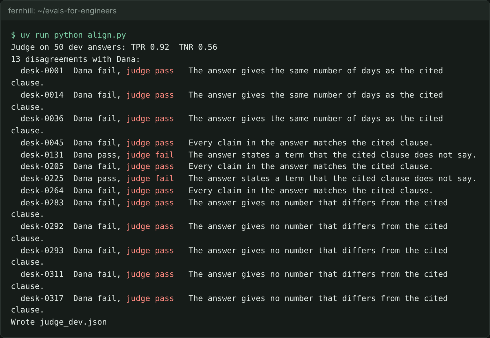

# Align the judge

## The problem

A judge that disagrees with Dana is worse than no judge, because the team will trust its number. The first draft of the prompt in this folder looks fine. It asks the judge to check that the numbers in an answer match the cited clauses. But Dana fails answers for more reasons than a wrong number. You find those reasons by reading every answer where the judge and Dana disagree.



## Your challenge

Use two numbers to measure the judge against Dana on the 50 dev answers:

- **TPR**: of the answers Dana passes, the share the judge passes too.
- **TNR**: of the answers Dana fails, the share the judge fails too.

Finish `tpr_tnr()` in `align.py` and run it:

```bash
uv run python align.py
```

Expect: `Judge on 50 dev answers: TPR 0.92  TNR 0.56`, then 13 disagreements, then `Wrote judge_dev.json`.

A TNR of 0.56 means the draft passes almost half of the bad answers. Read the disagreements. For example, the draft passes `desk-0036`:

```
desk-0036  Dana fail, judge pass   The answer gives the same number of days as the cited clause.
```

The answer says "180 days' notice". The clause says "not less than one hundred and eighty (180) days". The number matches, but the limit is gone. The draft has no rule about limits, so it cannot fail this answer.

Now fix `grounded.txt`. Add the rule each kind of disagreement breaks. Then write one row per change in `changes.csv`: `trace_id,change`. Name the answer that showed you the problem. Run `align.py` again until TPR and TNR are both at least 0.80.

Tune on dev only. Never look at the test split here. You use it once, in the next step.

**Without a key.** Replay knows the draft and Dana's finished prompt in `../solution/grounded.txt`. Read the disagreements, write your fix, then compare it with the sample and use the sample. **With a key**, record your own prompt on dev:

```bash
uv run python cases.py dev | uv run python run.py --record
```

Expect: 50 verdict lines, and new replies added to `recorded.jsonl`.

## Done when

- The judge's TPR and TNR on dev are both at least 0.80. The check runs your judge itself.
- `judge_dev.json` holds the TPR, TNR and every disagreement that your judge really gives.
- `changes.csv` names at least one disagreement and the rule you added for it.

```bash
bun run verify align-the-judge
```

Expect: `Done. All 7 rules pass.` and a `Progress:` line.

## If you get stuck

| What you see                                                             | Fix                                                                                        |
| ------------------------------------------------------------------------ | ------------------------------------------------------------------------------------------ |
| `FAIL the judge's TNR on dev is at least 0.80`                           | Read the rows that say `Dana fail, judge pass`. Each one is a rule your prompt is missing. |
| `FAIL the TPR and TNR in judge_dev.json match your judge's own verdicts` | Run `align.py` after your last change to `grounded.txt`. Never type the numbers.           |
| `FAIL the change log names a disagreement it fixes`                      | Put the trace id of a disagreement in `changes.csv`, with the rule you added for it.       |

## Words you will use

- **TPR (true positive rate)**: of the answers Dana passes, the share the judge passes.
- **TNR (true negative rate)**: of the answers Dana fails, the share the judge fails.
- **Disagreement**: an answer where the judge's verdict and Dana's label differ.
- **Align**: change the prompt until the judge agrees with the expert on answers it was not built from.
