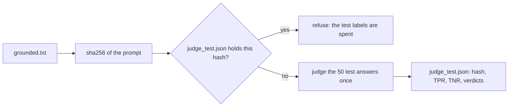

# Test the judge

## The problem

You tuned the judge on the dev answers until it agreed with Dana. So the dev numbers are too kind: the prompt was shaped by those very answers. To know how the judge does on answers it has never seen, you run it once on the 50 test answers. Once, because each look at the test split lets it shape the prompt too. After a second look, the test number means no more than the dev number.



## Your challenge

`test_once.py` runs the judge on the test split and writes `judge_test.json`. It saves a hash of `grounded.txt` with the result. A hash is a short fingerprint of a file: change one letter and the hash changes. Finish `already_tested()` so the script refuses a second run on the same prompt. Then run it once:

```bash
uv run python test_once.py
```

Expect: `Judge on 50 test answers: TPR 0.92  TNR 0.88` and `Wrote judge_test.json`.

Run it again to see the guard work:

```bash
uv run python test_once.py
```

Expect: `Refused: this prompt already has a test run in judge_test.json.`

For example, the sample answer's `judge_test.json` starts like this:

```json
{
  "prompt_sha256": "961540d7b9ccf27df5f3c5aa545525532680a48e14d43dfb18eda27382fde550",
  "n": 50,
  "tpr": 0.92,
  "tnr": 0.88,
  "verdicts": { "desk-0005": "fail", ... }
}
```

If you change the prompt after this, the hash no longer matches and the check fails. Go back to dev, tune, and test the new prompt once. Report the number you got, even if it is lower than on dev. That lower number is the honest one.

## Done when

- `judge_test.json` was made with the prompt in `grounded.txt` now.
- It holds a verdict for all 50 test answers, and a replay run gives the same verdicts.
- Its TPR and TNR match those verdicts, and both are at least 0.80.
- Running `test_once.py` a second time on the same prompt is refused.

```bash
bun run verify test-the-judge
```

Expect: `Done. All 6 rules pass.` and a `Progress:` line.

## If you get stuck

| What you see                                                        | Fix                                                                                       |
| ------------------------------------------------------------------- | ----------------------------------------------------------------------------------------- |
| `FAIL a second test run on the same prompt is refused`              | `already_tested()` must read `judge_test.json` and compare its hash with the current one. |
| `FAIL judge_test.json was made with the prompt in grounded.txt now` | The prompt changed after the test run. Tune on dev, then test the new prompt once.        |
| `FAIL TPR and TNR on the test split are both at least 0.80`         | The judge does worse on unseen answers. Go back to `align-the-judge` and read the misses. |

## Words you will use

- **Held-out labels**: labels kept apart while you build the judge, used once to measure it.
- **Hash**: a short fingerprint of a file. Any change to the file gives a new hash.
- **Test split**: Dana's 50 test labels, 25 pass and 25 fail.
