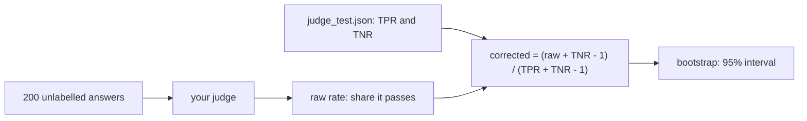

# Correct the pass rate

## The problem

Fernhill wants one number for the report card: how many lease desk answers are grounded? The judge can grade the 200 answers Dana never labelled. But the judge makes mistakes, and you know how often. It passes 92% of good answers (TPR 0.92) and fails 88% of bad ones (TNR 0.88). So it lets 12% of bad answers through, and it fails 8% of good ones. Its raw pass rate is not the true rate.



## Your challenge

First, from the repo root: `cd parts/03-judge-what-code-cannot/05-correct-the-pass-rate/problem`.

Finish `corrected()` in `rate.py`. It takes the raw rate, TPR and TNR, and returns the true pass rate:

```
corrected = (raw + TNR - 1) / (TPR + TNR - 1)
```

This is the Rogan-Gladen estimator, first made for medical tests that are sometimes wrong ([Rogan and Gladen, 1978](https://doi.org/10.1093/oxfordjournals.aje.a112510)). Keep the result between 0 and 1. Then run the script:

```bash
uv run python rate.py
```

Expect: `Judge passes 162 of 200 answers: raw rate 81%`, then `Corrected with TPR 0.92 and TNR 0.88: 86%`, a `95% interval:` line and `Wrote grounded_rate.json`.

For example, take the sample numbers. The raw rate is 162 / 200 = 0.81. The top line is 0.81 + 0.88 - 1 = 0.69. The bottom line is 0.92 + 0.88 - 1 = 0.80. So the corrected rate is 0.69 / 0.80 = 0.8625, about 86%. The judge's mistakes hid about 5 points of grounded answers.

The script also gives a 95% interval, from a bootstrap. A bootstrap draws the test labels and the verdicts again many times, with repeats allowed. It corrects each draw and keeps the middle 95% of the results. With only 50 test labels the interval is wide: 74% to 100%. That width is part of the answer. It tells Dana how sure the number is.

## Done when

- `grounded_rate.json` covers the 200 unlabelled answers.
- Its raw rate matches your judge's verdicts. The check runs your judge itself.
- Its TPR and TNR are the ones in `judge_test.json`.
- Its corrected rate matches the formula within 0.01, and its interval holds that rate.

```bash
bun run verify correct-the-pass-rate
```

Expect: `Done. All 6 rules pass.` and a `Progress:` line.

## If you get stuck

| What you see                                                                    | Fix                                                                             |
| ------------------------------------------------------------------------------- | ------------------------------------------------------------------------------- |
| `NotImplementedError: corrected() is still the starter`                         | Finish `corrected()`. It is three lines: the guard, the formula, and the clip.  |
| `FAIL the corrected rate matches (raw + TNR - 1) / (TPR + TNR - 1) within 0.01` | Check that TNR is in the top line, and that you did not swap TPR and TNR.       |
| `FAIL TPR and TNR are the ones judge_test.json measured`                        | Read them from `judge_test.json`. Dev numbers were tuned, so they are too kind. |

## Words you will use

- **Raw rate**: the share of answers the judge passes, before any correction.
- **Corrected rate**: the share of answers that are really grounded, once the judge's known mistakes are taken out.
- **Bootstrap**: draw the data again many times, with repeats, to see how much a number moves.
- **95% interval**: the range that holds the true rate in 95 of 100 such studies.
