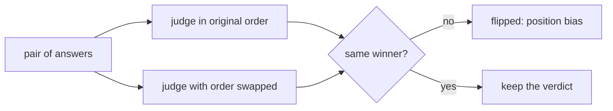

# Check the judge for bias

## The problem

A judge can like the first answer it reads, or the longer one, and not the better one. Your judge agreed with Dana on the labels, but those labels did not test order. Here 20 pairs were judged twice, the second time with the two answers swapped. If the winner changes when only the order changes, the judge is reading position and not quality.



## Your challenge

First, from the repo root: `cd parts/03-judge-what-code-cannot/06-check-the-judge-bias/problem`.

Open `judge_runs.jsonl`. Each line is one pair. `picked_original` and `picked_swapped` name the answer the judge chose, `a` or `b`. `longer` names the longer answer.

For example, this pair flipped, because the judge chose `a` in one order and `b` in the other:

```json
{ "pair": "pair-03", "picked_original": "a", "picked_swapped": "b", "longer": "a" }
```

Finish the three functions in `bias_report.py`. Then write one sentence in `FIX` that says what you will do about it.

```bash
uv run python bias_report.py
```

Expect: `Flip rate 0.3: 6 of 20 pairs.` and `Wrote bias_report.json`.

## Done when

- `flip_rate` is the share of pairs where the winner changed.
- `longer_pick_rate` is the share of pairs where the judge chose the longer answer.
- `flipped_pairs` lists each flipped pair and no other.
- `fix` says to swap the order and judge twice.

```bash
bun run verify check-the-judge-bias
```

Expect: `Done. All 5 rules pass.` and a `Progress:` line.

## If you get stuck

| What you see                                             | Fix                                                                       |
| -------------------------------------------------------- | ------------------------------------------------------------------------- |
| `FAIL flip_rate is the share of pairs where swapping...` | You counted pairs that agree. Count the pairs where the two picks differ. |
| `FAIL fix says to swap the order and ask twice`          | Name the swap and say you judge both orders.                              |
| `NotImplementedError`                                    | Replace the `raise` line in each of the three functions with your code.   |

The sample answer is in `../solution/bias_report.py`. Open it after you have tried.

## Words you will use

- **Position bias**: a judge that favours an answer because of where it sits, not what it says.
- **Length bias**: a judge that favours the longer answer.
- **Flipped pair**: a pair whose winner changes when the order is swapped.
