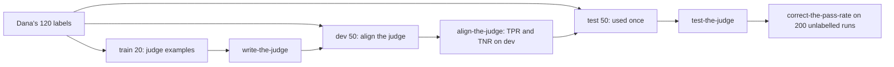

# Judge what code cannot

## The problem

Some questions have no exact right answer for code to compare. Here is one: "Is this lease desk answer supported by the clause it cites?" Dana can tell at a glance. An answer that its cited clause supports is called grounded.

For example, staff asked a question about lease L100: "How much notice does the tenant in unit 8D at Juniper Hall need to give to renew?"

Clause c12 of the lease says "not less than thirty (30) days". Here are two real answers from `world/data/traces/lease_desk.jsonl`:

- `desk-0001`: "Exactly 30 days' written notice is needed [L100-c12]."
- `desk-0002`: "The tenant must give written notice not less than 30 days before the end of the term [L100-c12]."

The first answer turns "not less than" into "exactly", so the clause does not support it. Dana's label for it in `world/data/labels/grounded.csv` is the row `desk-0001,dev,fail`. Comparing strings in code cannot see this kind of difference. A model can.

Fernhill wants a grounded rate on every release. A model can grade the answers. A model that grades another model's output is called a judge. But a judge that disagrees with Dana is worse than no judge, because the team will trust its number.

## Why it matters

Anthropic's engineering team calls judges LLM-as-judge graders. Its advice: judges "should be closely calibrated with human experts to gain confidence that there is little divergence between the human grading and model grading". The source is [Demystifying evals for AI agents](https://www.anthropic.com/engineering/demystifying-evals-for-ai-agents), from Anthropic.

This part measures how far the judge is from Dana. It uses two numbers, on labels the judge has never seen:

- **TPR** (true positive rate): of the answers Dana passes, the share the judge also passes.
- **TNR** (true negative rate): of the answers Dana fails, the share the judge also fails.

Then you correct the judge's pass rate for its known errors. For example, `uv run fernhill report` prints this for the finished judge: `86% (95% interval 74% to 100%)   judge TPR 0.92 TNR 0.88 on 50 held-out labels`.

## Steps

| Step                    | Minutes | You produce                                                                        | The check reads                                                                             |
| ----------------------- | ------- | ---------------------------------------------------------------------------------- | ------------------------------------------------------------------------------------------- |
| `label-the-answers`     | 25      | `labels.csv`: 30 lease desk answers labelled grounded or not, each with a critique | your labels against Dana's, reported as Cohen's kappa between two people                    |
| `write-the-judge`       | 20      | `grounded.md` and a `judge` command that meets the contract                        | the command run on the train split, three runs in replay; no dev or test text in the prompt |
| `align-the-judge`       | 25      | `judge_dev.json`: TPR, TNR and every disagreement on dev, with a change log        | TPR and TNR recomputed from your judge's own outputs, both at least 0.80                    |
| `test-the-judge`        | 10      | `judge_test.json`: one run on the 50 test labels                                   | one run per prompt hash, TPR and TNR at least 0.80                                          |
| `correct-the-pass-rate` | 10      | `grounded_rate.json`: raw rate, corrected rate, 95% interval                       | the formula recomputed within 0.01, the interval holds the estimate                         |

## Walkthrough

TODO(part session): one command per step, each followed by its Expect: line.

## What you can show

You can show a judge with its TPR and TNR on held-out labels: labels you kept apart while you built the judge. You can also show a corrected grounded rate with its interval. Together they make the second line of the report card.
