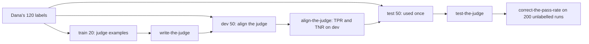

# Judge what code cannot

## The problem

"Is this lease desk answer supported by the clause it cites?" has no exact right answer, but Dana can tell at a glance. Fernhill wants a number for it on every release. A model can grade it, but a judge that disagrees with Dana is worse than no judge, because the team will trust its number.

## Why it matters

Anthropic's engineering team writes that LLM-as-judge graders "should be closely calibrated with human experts to gain confidence that there is little divergence between the human grading and model grading" ([Demystifying evals for AI agents](https://www.anthropic.com/engineering/demystifying-evals-for-ai-agents), Anthropic). This part measures that divergence: the judge's true positive and true negative rates on labels it has never seen, and a pass rate corrected for its errors.

## Steps

| Step | Minutes | You produce | The check reads |
|---|---|---|---|
| `label-the-answers` | 25 | `labels.csv`: 30 lease desk answers labelled grounded or not, each with a critique | your labels against Dana's, reported as Cohen's kappa between two people |
| `write-the-judge` | 20 | `grounded.md` and a `judge` command that meets the contract | the command run on the train split, three runs in replay; no dev or test text in the prompt |
| `align-the-judge` | 25 | `judge_dev.json`: TPR, TNR and every disagreement on dev, with a change log | TPR and TNR recomputed from your judge's own outputs, both at least 0.80 |
| `test-the-judge` | 10 | `judge_test.json`: one run on the 50 test labels | one run per prompt hash, TPR and TNR at least 0.80 |
| `correct-the-pass-rate` | 10 | `grounded_rate.json`: raw rate, corrected rate, 95% interval | the formula recomputed within 0.01, the interval holds the estimate |

## Walkthrough

TODO(part session): one command per step, each followed by its Expect: line.

## What you can show

A judge with TPR and TNR on held-out labels, and a corrected grounded rate with its interval: the second line of the report card.
