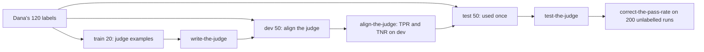

# Judge what code cannot

## The problem

Some questions have no exact right answer for code to compare. Here is one: "Is this lease desk answer supported by the clause it cites?" Dana can tell at a glance. An answer that its cited clause supports is called grounded.

For example, staff asked a question about lease L100: "How much notice does the tenant in unit 8D at Juniper Hall need to give to renew?"

Clause c12 of the lease says "not less than thirty (30) days". Here are two real answers from `world/data/traces/lease_desk.jsonl`:

- `desk-0001`: "Exactly 30 days' written notice is needed [L100-c12]."
- `desk-0002`: "The tenant must give written notice not less than 30 days before the end of the term [L100-c12]."

The first answer turns "not less than" into "exactly", so the clause does not support it. Dana's label for it in `world/data/labels/grounded.csv` is the row `desk-0001,dev,fail`. Comparing strings in code cannot see this kind of difference. A model can.

Fernhill wants a grounded rate on every release. A model can grade the answers. A model that grades another model's output is called a judge. But a judge that disagrees with Dana is worse than no judge, because the team will trust its number.

## Why it matters

Anthropic's engineering team calls judges LLM-as-judge graders. Its advice: judges "should be closely calibrated with human experts to gain confidence that there is little divergence between the human grading and model grading". The source is [Demystifying evals for AI agents](https://www.anthropic.com/engineering/demystifying-evals-for-ai-agents), from Anthropic.

This part measures how far the judge is from Dana. It uses two numbers, on labels the judge has never seen:

- **TPR** (true positive rate): of the answers Dana passes, the share the judge also passes.
- **TNR** (true negative rate): of the answers Dana fails, the share the judge also fails.

Then you correct the judge's pass rate for its known errors. For example, `uv run fernhill report` prints this for the finished judge: `86% (95% interval 74% to 100%)   judge TPR 0.92 TNR 0.88 on 50 held-out labels`.



## Steps

| Step                    | Minutes | You produce                                                                        | The check reads                                                                             |
| ----------------------- | ------- | ---------------------------------------------------------------------------------- | ------------------------------------------------------------------------------------------- |
| `label-the-answers`     | 25      | `labels.csv`: 30 lease desk answers labelled grounded or not, each with a critique | your labels against Dana's, reported as Cohen's kappa between two people                    |
| `write-the-judge`       | 20      | `grounded.txt` and `run.py`, a judge command that meets the contract               | the command run on the train split, three runs in replay; no dev or test text in the prompt |
| `align-the-judge`       | 25      | `judge_dev.json`: TPR, TNR and every disagreement on dev, with a change log        | TPR and TNR recomputed from your judge's own outputs, both at least 0.80                    |
| `test-the-judge`        | 10      | `judge_test.json`: one run on the 50 test labels                                   | one run per prompt hash, TPR and TNR at least 0.80                                          |
| `correct-the-pass-rate` | 10      | `grounded_rate.json`: raw rate, corrected rate, 95% interval                       | the formula recomputed within 0.01, the interval holds the estimate                         |

Each step starts from the sample answer of the step before it. So you can start at any step.

## The judge contract

Every step runs your judge the same way, so any tool or framework can sit behind it. `run.py` reads one answer per line on stdin and prints one verdict per line:

- In: `{"id": "desk-0009", "question": "...", "answer": "...", "cited_clauses": [{"id": "L106-c12", "text": "..."}]}`
- Out: `{"id": "desk-0009", "verdict": "fail", "critique": "..."}`

Every id is answered once. The verdict is always `pass` or `fail`, never a score.

**About keys.** With no key, replay answers only prompts that were recorded: the first draft in `align-the-judge` and Dana's finished prompt. To grade with your own prompt, set `LLM_PROVIDER` and one key in `.env` and add `--record`. Your judge saves each real reply in `recorded.jsonl`. After that, the checks replay your own prompt with no key.

## Walkthrough

Work in each step's `problem/` folder. From the repo root, label the answers first. Fill in `labels.csv`, finish `cohens_kappa()`, then:

```bash
cd parts/03-judge-what-code-cannot/01-label-the-answers/problem && uv run python kappa.py && cd -
```

Expect: `You and Dana agree on` with a count of 30, a `Cohen's kappa:` line and `Wrote agreement.json`.

```bash
bun run verify label-the-answers
```

Expect: `Done. All 5 rules pass.`

Write `grounded.txt` and finish `read_verdict()` in `run.py`, then run the judge on the 20 train answers:

```bash
cd parts/03-judge-what-code-cannot/02-write-the-judge/problem && uv run python cases.py train | uv run python run.py && cd -
```

Expect: 20 lines like `{"id": "desk-0009", "verdict": "fail", "critique": "..."}`. With no key, this works once your prompt is one replay knows.

```bash
bun run verify write-the-judge
```

Expect: `Done. All 7 rules pass.`

Finish `tpr_tnr()` in `align.py` and run it on the first draft:

```bash
cd parts/03-judge-what-code-cannot/03-align-the-judge/problem && uv run python align.py && cd -
```

Expect: `Judge on 50 dev answers: TPR 0.92  TNR 0.56` and 13 disagreements. Fix `grounded.txt`, log each change in `changes.csv`, and run `align.py` again until both numbers are at least 0.80.

```bash
bun run verify align-the-judge
```

Expect: `Done. All 7 rules pass.`

Finish `already_tested()` in `test_once.py`, then run the judge once on the test split:

```bash
cd parts/03-judge-what-code-cannot/04-test-the-judge/problem && uv run python test_once.py && cd -
```

Expect: `Judge on 50 test answers: TPR 0.92  TNR 0.88` and `Wrote judge_test.json`.

```bash
bun run verify test-the-judge
```

Expect: `Done. All 6 rules pass.`

Finish `corrected()` in `rate.py`, then:

```bash
cd parts/03-judge-what-code-cannot/05-correct-the-pass-rate/problem && uv run python rate.py && cd -
```

Expect: `Corrected with TPR 0.92 and TNR 0.88: 86%` and `95% interval: 74% to 100%`.

```bash
bun run verify part judge-what-code-cannot
```

Expect: this table.

```
Part judge-what-code-cannot:
  PASS   label-the-answers  (5/5 rules)
  PASS   write-the-judge  (7/7 rules)
  PASS   align-the-judge  (7/7 rules)
  PASS   test-the-judge  (6/6 rules)
  PASS   correct-the-pass-rate  (6/6 rules)
Part judge-what-code-cannot is done: 5/5 steps pass.
```

## Finished

You now have a grounded judge that you can trust, and the proof of it. You have a prompt with one criterion and a pass or fail verdict. You have its TPR and TNR on 50 held-out labels, measured once. And you have a corrected grounded rate with a 95% interval. That is the second line of the report card:

```
Lease desk grounded (corrected) .... 86% (95% interval 74% to 100%)   judge TPR 0.92 TNR 0.88 on 50 held-out labels
```

The next part, Gate the change, puts this judge and the code checks from Check with code into a release gate. The gate blocks the `cheaper-model` release that an average would let through.

## Assignment

**The problem.** "Is this answer supported by the clause it cites?" A judge that disagrees with Dana is worse than none.

**Hand in** these files from your step folders: `grounded.txt`, `run.py` (the judge command), `judge_dev.json` with `changes.csv`, `judge_test.json` and `grounded_rate.json`. If you used your own prompt, hand in `recorded.jsonl` too.

**Rubric.** Each question is yes or no.

| #   | Question                                                                                           | How it is checked                      |
| --- | -------------------------------------------------------------------------------------------------- | -------------------------------------- |
| 1   | Do you have 30 labels, each with a critique, and the kappa they really give?                       | `bun run verify label-the-answers`     |
| 2   | Does the judge meet the contract, give only pass or fail, and keep dev and test out of the prompt? | `bun run verify write-the-judge`       |
| 3   | Are TPR and TNR both at least 0.80 on dev, computed by the check, with a change log?               | `bun run verify align-the-judge`       |
| 4   | Are TPR and TNR both at least 0.80 on the test split, from one run of this prompt?                 | `bun run verify test-the-judge`        |
| 5   | Does the corrected rate match the formula within 0.01, with an interval that holds it?             | `bun run verify correct-the-pass-rate` |

**Extension.** Swap the judge to a cheaper model by changing the `judge` role in `config/models.py`. Record it on dev and test. Then show with TPR, TNR and the width of the interval if the saving is worth it.
