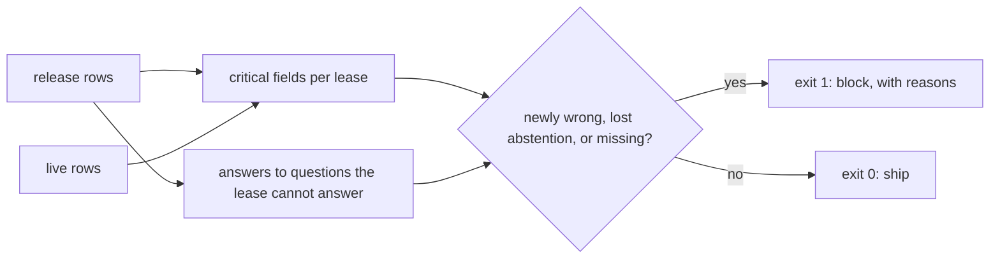
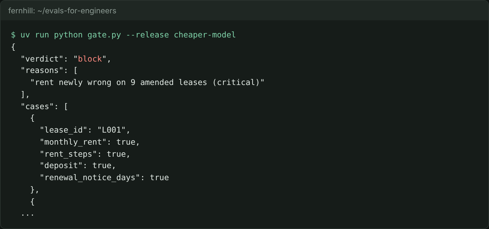

# Gate the release

## The problem

Someone wants to move the abstractor to a cheaper model. A release is one version of the system that you might ship. Its outputs are in `world/data/releases/`.

The gate today looks only at the average field accuracy on the 50 gate leases. It blocks when accuracy drops by more than 2 points.

Work in this step's `problem/` folder. From the repo root, go there first with `cd parts/04-gate-the-change/01-gate-the-release/problem`.

For example, run the starter on the cheaper model:

```bash
uv run python gate.py --release cheaper-model
```

Expect: `"verdict": "ship"` and the reason `field accuracy drops 1.3 points; the limit is 2.0`.

But the cheaper model gets the rent wrong on 9 amended leases, such as L040. Owners would get wrong rent letters.



## Your challenge

Rewrite `gate()` in `gate.py` so it blocks a release for any of three reasons:

1. A critical field is newly wrong. The critical fields are in `leases.CRITICAL`: rent, rent steps, deposit and renewal notice days. Newly wrong means live gets it right and the release does not.
2. An abstention is lost: live says "The lease does not say." to a question, and the release does not.
3. A case has no result. A row with `"output": null` timed out, or a gate lease has no row at all. When you cannot score a case, block. This is called failing closed.

Each reason names the field. Read trial 1 only; the next step uses all three.

The starter uses the field checks in `fernhill.evals.fields`. You can swap in your own from Check with code.

When you finish, the same command prints this:



## Done when

- `live` and `clause-ids-in-answer` ship with exit 0.
- `cheaper-model` is blocked with exit 1, and a reason names the rent.
- `shorter-prompt` is blocked, because it stops saying "The lease does not say.".
- A release where a case timed out, or a gate lease is missing, is blocked.

```bash
bun run verify gate-the-release
```

Expect: `Done. All 7 rules pass.` and a `Progress:` line.

## If you get stuck

| What you see                                                                        | Fix                                                                                                                |
| ----------------------------------------------------------------------------------- | ------------------------------------------------------------------------------------------------------------------ |
| `FAIL the gate ships clause-ids-in-answer, a harmless change`                       | Compare with live. A field that live also gets wrong did not get worse, so it must not block.                      |
| `FAIL the gate blocks when a case times out (it fails closed)`                      | Do not skip a row with no output and carry on. Count its lease as missing, and block when anything is missing.     |
| `FAIL the gate blocks shorter-prompt, which stops saying 'The lease does not say.'` | Read the rows where `kind` is `desk`. Find the questions with `answerable: false` in `world/data/questions.jsonl`. |

The sample answer is in `../solution/gate.py`. Open it after you have tried.

## Words you will use

- **Release**: one version of a system that you might ship.
- **Gate**: a check that decides if a release may ship. Exit 0 means ship, exit 1 means block.
- **Critical field**: a field where one wrong value costs real money, such as the monthly rent.
- **Fail closed**: when a result is missing, block. Never ship on what you could not check.
