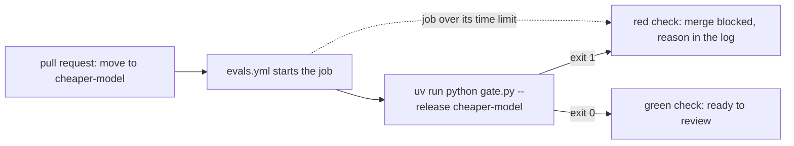

# Run the gate in CI

## The problem

Your gate works when you remember to run it. People forget, mostly when they are in a hurry. CI (continuous integration) is a service that runs your checks on every change, before anyone can merge it. Fernhill's CI runs only after a merge, and it never calls the gate.

For example, someone opens a pull request that moves the abstractor to `cheaper-model`. Today nothing runs until it is merged. By then, owners already get letters with the wrong rent for L040. With the gate in CI, the pull request shows a red check before the merge. The gate's reason is in the log: `rent newly wrong on 9 amended leases (critical)`.



This step has no screenshot. A real check run needs a GitHub repo of your own, and this course never writes to `.github/`. The diagram shows what you will see.

## Your challenge

Finish `evals.yml` in this folder. It is a GitHub Actions workflow. Make it:

1. Run on every pull request (`on: pull_request`), not only after a merge.
2. Call the gate with `uv run python gate.py --release <name>`. An exit of 1 turns the check red.
3. Stop the job after a time limit with `timeout-minutes`. A gate that hangs then fails, and never waits forever.
4. Set `LLM_PROVIDER`. Read any key from the repo's secrets, never from the file.
5. Name no model. The judge is a role in `config/models.py`, so the model lives in one place.

In your own repo, copy the finished file to `.github/workflows/evals.yml`. Then open a pull request to see the check run.

## Done when

- `evals.yml` runs on `pull_request` and calls `uv run python gate.py --release`.
- Every job has `timeout-minutes` of 60 or less.
- `LLM_PROVIDER` is set, and every key is a `secrets.` expression.
- No model name appears in the file.

```bash
bun run verify run-the-gate-in-ci
```

Expect: `Done. All 7 rules pass.` and a `Progress:` line.

## If you get stuck

| What you see                                                        | Fix                                                                                                     |
| ------------------------------------------------------------------- | ------------------------------------------------------------------------------------------------------- |
| `FAIL it runs on pull requests`                                     | Under `on:`, add `pull_request:`. A gate after the merge is too late.                                   |
| `FAIL every key comes from the repo's secrets, never from the file` | Never paste a key. Store it in the repo settings under Secrets, and read it as a `secrets.` expression. |
| `FAIL every job has a time limit of 60 minutes or less`             | Add `timeout-minutes: 15` to the job, at the same level as `runs-on`.                                   |

The sample answer is in `../solution/evals.yml`. Open it after you have tried.

## Words you will use

- **CI**: continuous integration, a service that runs your checks on every change before a merge.
- **Workflow**: a YAML file that tells GitHub Actions when to run and what to run.
- **Secret**: a value, such as a key, that you store in the repo settings and never in a file.
