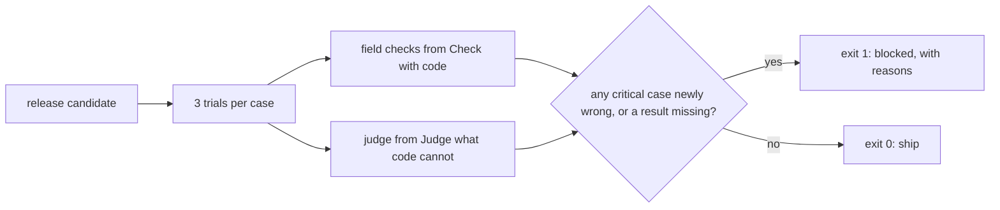

# Gate the change

## The problem

Someone wants to move the abstractor to a cheaper model. Its average field accuracy drops by only 1.3 points, so a gate on the average lets it through. But it gets the rent wrong on 9 more amended leases, which are the leases owners complain about.

## Why it matters

Anthropic's engineering team shows why one passing run proves little: "If your agent has a 75% per-trial success rate and you run 3 trials, the probability of passing all three is (0.75)³ ≈ 42%" ([Demystifying evals for AI agents](https://www.anthropic.com/engineering/demystifying-evals-for-ai-agents), Anthropic). A gate has to repeat each case, decide on a stated share of trials, never average a critical failure away, and block when a result is missing.

## Steps

| Step                 | Minutes | You produce                                                      | The check reads                                                                      |
| -------------------- | ------- | ---------------------------------------------------------------- | ------------------------------------------------------------------------------------ |
| `gate-the-release`   | 25      | a `gate` command: exit 0 to ship, 1 to block, with a JSON report | exit codes on the four releases in `world/data/releases`, and on an injected timeout |
| `repeat-the-trials`  | 15      | pass@3 and pass^3 per case in the gate report                    | the numbers recomputed; the flaky case does not block `clause-ids-in-answer`         |
| `run-the-gate-in-ci` | 15      | `evals.yml`: a CI workflow that runs the gate on pull requests   | the workflow file linted: trigger, gate command, judge role, timeout                 |

## Walkthrough

TODO(part session): one command per step, each followed by its Expect: line.

## What you can show

Two lines side by side: the average gate passing `cheaper-model`, and your gate blocking it with the reason "rent newly wrong on 9 amended leases".
