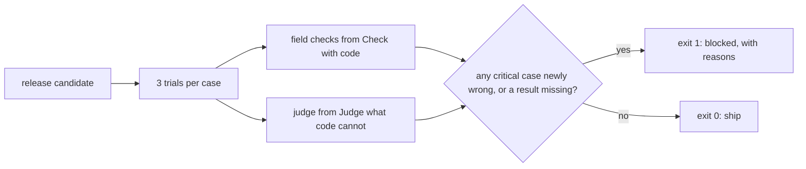

# Gate the change

## The problem

A gate is a check that decides if a release may ship. Someone wants to move the abstractor to a cheaper model. Its average field accuracy drops by only 1.3 points, so a gate on the average lets it through. But it gets the rent wrong on 9 more amended leases. Those are the leases owners complain about.

For example, here are two gates on the same release. The average gate prints `Average gate on cheaper-model: PASS (field accuracy drops 1.3 points; the limit is 2.0)`. The gate you build prints `Gate on cheaper-model: BLOCKED`, with the reason `rent newly wrong on 9 amended leases (critical)`. One of those leases is L040. There, the cheaper model misses Amendment No. 1 in every trial.

## Why it matters

A trial is one run of a case. Anthropic's engineering team shows why one passing trial proves little: "If your agent has a 75% per-trial success rate and you run 3 trials, the probability of passing all three is (0.75)³ ≈ 42%". The source is [Demystifying evals for AI agents](https://www.anthropic.com/engineering/demystifying-evals-for-ai-agents), from Anthropic.

So a good gate follows four rules:

- It runs each case more than once.
- It decides on a share of trials that you set in advance.
- It never lets an average hide a critical failure.
- It blocks when a result is missing. This is called failing closed.



## Steps

| Step                 | Minutes | You produce                                                      | The check reads                                                                      |
| -------------------- | ------- | ---------------------------------------------------------------- | ------------------------------------------------------------------------------------ |
| `gate-the-release`   | 25      | a `gate` command: exit 0 to ship, 1 to block, with a JSON report | exit codes on the four releases in `world/data/releases`, and on an injected timeout |
| `repeat-the-trials`  | 15      | pass@3 and pass^3 per case in the gate report                    | the numbers recomputed; the flaky case does not block `clause-ids-in-answer`         |
| `run-the-gate-in-ci` | 15      | `evals.yml`: a CI workflow that runs the gate on pull requests   | the workflow file linted: trigger, gate command, judge role, timeout                 |

## Walkthrough

Work in each step's `problem/` folder. Each step starts from the sample answer of the step before it, so you can start at any step. From the repo root, first see the average gate let the cheaper model through:

```bash
uv run fernhill gate --release cheaper-model --average-only
```

Expect: `Average gate on cheaper-model: PASS (field accuracy drops 1.3 points; the limit is 2.0)`.

Then finish `gate()` in `01-gate-the-release/problem/gate.py` and run it on the same release:

```bash
cd parts/04-gate-the-change/01-gate-the-release/problem && uv run python gate.py --release cheaper-model; cd -
```

Expect: `"verdict": "block"` and the reason `rent newly wrong on 9 amended leases (critical)`.

```bash
bun run verify gate-the-release
```

Expect: `Done. All 7 rules pass.`

Add the trials in `02-repeat-the-trials/problem/gate.py`, then run the harmless release:

```bash
cd parts/04-gate-the-change/02-repeat-the-trials/problem && uv run python gate.py --release clause-ids-in-answer; cd -
```

Expect: `"verdict": "ship"`, with the L001 rent case at `"pass_hat_3": 0.2963`.

```bash
bun run verify repeat-the-trials
```

Expect: `Done. All 8 rules pass.`

Finish `03-run-the-gate-in-ci/problem/evals.yml`, then:

```bash
bun run verify run-the-gate-in-ci
```

Expect: `Done. All 7 rules pass.`

```bash
bun run verify part gate-the-change
```

Expect: this table, ending with the line `Part gate-the-change is done: 3/3 steps pass.`

```
Part gate-the-change:
  PASS   gate-the-release  (7/7 rules)
  PASS   repeat-the-trials  (8/8 rules)
  PASS   run-the-gate-in-ci  (7/7 rules)
Part gate-the-change is done: 3/3 steps pass.
```

## Finished

You now have a gate that a pull request cannot get past by luck. For example, it blocks `cheaper-model` and names the rent. It ships `clause-ids-in-answer`, even though L001 is flaky. It blocks any release it cannot fully score. And `evals.yml` runs it on every pull request, with a time limit and the key kept in secrets.

The gate only knows the cases in its set. Next, in Watch production, you sample live lease desk traces in batches and judge them. When a new lease template breaks the desk, you add those failures back as new gate cases.

## What you can show

You can show two lines side by side. The average gate passes `cheaper-model`. Your gate blocks it, with the reason "rent newly wrong on 9 amended leases".

## Assignment

**The problem.** The cheaper model saves money on every lease. On average it loses only 1.3 points. But it gets the rent wrong on amended leases, the leases owners complain about. Prove that your gate catches this, and that it does not block a safe release.

**What you hand in**, in your own repo:

- `gate.py`, with 3 trials per case and the report from this part.
- `.github/workflows/evals.yml`, copied from your `evals.yml`.
- One pull request that proposes `cheaper-model`, with its red check, and one that proposes `clause-ids-in-answer`, with its green check.

**How it is graded.** Each line is yes or no:

| #   | Question                                                                      | How it is checked                              |
| --- | ----------------------------------------------------------------------------- | ---------------------------------------------- |
| 1   | Does the gate exit 1 on `cheaper-model`, with a reason that names the rent?   | `bun run verify gate-the-release`              |
| 2   | Does the gate exit 0 on `clause-ids-in-answer`?                               | `bun run verify gate-the-release`              |
| 3   | Does the gate exit 1 when a case times out, or a gate lease is missing?       | `bun run verify gate-the-release` injects both |
| 4   | Do pass@3 and pass^3 match the trials of every case?                          | `bun run verify repeat-the-trials`             |
| 5   | Does the flaky lease L001 leave `clause-ids-in-answer` unblocked?             | `bun run verify repeat-the-trials`             |
| 6   | Does the workflow run on pull requests, call the gate, and have a time limit? | `bun run verify run-the-gate-in-ci`            |
| 7   | Does every key come from secrets, with no model named in the workflow?        | `bun run verify run-the-gate-in-ci`            |
| 8   | Is the red check on the `cheaper-model` pull request public?                  | A reviewer opens the link                      |

**Extension.** Add a written override: a file next to the release with a name and a reason. Make the gate ship a blocked release only when the override exists, and print who signed it.
