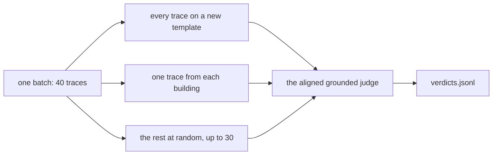

# Sample production traces

## The problem

The lease desk runs in batches of 40 traces. The CI gate only tests leases in the golden set. From batch 5 on, staff also ask about 10 leases on a new template, FH-RES-2026. The golden set has no lease on it, so CI never sees these answers.

You grade a sample of each batch with the judge you aligned with Dana. A careless sample can miss the traces you most need to see.



## Your challenge

Finish two functions in `monitor.py`:

1. `sample_batch()` picks at least 30 traces from one batch. First take every trace on a template the golden set lacks. Then add one trace from each building that has none yet. Then fill the rest at random.
2. `grade()` asks the aligned grounded judge for its verdict on one trace.

`monitor.py` already reads the traces, marks each with `new_template`, and writes `verdicts.jsonl`.

For example, trace `prod-5-12` is about lease L126, on FH-RES-2026. Staff asked for the monthly rent of unit 1C. The lease desk answered: "No, the lease forbids it [L126-c02]." Your sample must hold this trace. Its line in `verdicts.jsonl` is:

```
{"batch": 5, "building": "Rowan Steps", "template": "FH-RES-2026", "trace_id": "prod-5-12", "verdict": "fail"}
```

```bash
uv run python monitor.py --seed 7
```

Expect: `Graded 210 production traces: 134 pass.` and the path of `verdicts.jsonl`. Your random picks can change the count a little. The judge runs in replay mode, so you need no key.

## Done when

- `monitor.py --seed 7` grades at least 30 real traces in each of the 7 batches, with no repeats.
- Every building in a batch has a trace in the sample.
- Every trace on a template the golden set lacks is in the sample.
- Every verdict is the aligned judge's verdict.
- The same seed gives the same sample, and a different seed gives a different one.

```bash
bun run verify sample-production-traces
```

Expect: `Done. All 8 rules pass.` and a `Progress:` line.

## If you get stuck

| What you see | Fix |
| --- | --- |
| `FAIL monitor.py --seed 7 runs and grades at least 30 traces ...` | Run the script and read the error. `NotImplementedError` means a function is still the starter. |
| `FAIL every trace on a template the golden set lacks is in the ...` | A plain random draw leaves some new-template traces out. Take all of them first. |
| `FAIL every building in a batch has at least one trace ...` | Batch 1 has 23 buildings. Add one trace for each building the sample lacks. |
| `FAIL every verdict is the aligned grounded judge's verdict` | Call `judge.judge()`. A quick rule such as "it cites a clause, so it passes" passes every trace. |

The sample answer is in `../solution/monitor.py`. Open it after you have tried.

## Words you will use

- **Production trace**: the record of one real run, when staff used the system for their work.
- **Batch**: a group of production traces graded together. Here, each batch holds 40 traces.
- **Template**: the standard text a lease starts from. Leases on one template share their wording.
- **Coverage**: which kinds of input your tests hold.
