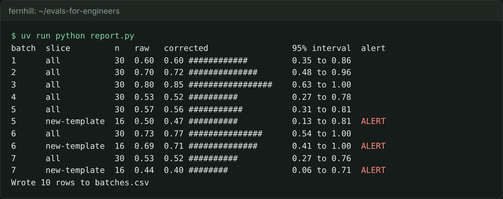

# Report the batch rate

## The problem

You have the judge's verdicts on a sample of every batch. But the judge makes mistakes. On Dana's 50 held-out labels, it passes 92% of the good answers (its TPR) and fails 88% of the bad ones (its TNR). So its raw pass rate is off, and you must correct it.

A rate over all traces can also hide a problem. The known templates already run at about 0.75 in some batches, so a drop on 16 new-template traces gets lost in the mix. You need the new template as its own slice, with its own alert.



## Your challenge

Finish two functions in `report.py`:

1. `rate_row()` turns one group of verdicts into a row: `n`, `raw_rate`, `corrected_rate`, and the 95% interval `ci_low` to `ci_high`. Use `stats.tpr_tnr()`, `stats.corrected()` and `stats.bootstrap()` from the finished system.
2. `should_alert()` says yes on a `new-template` row whose corrected rate is below `ALERT_FLOOR`, 0.75. CI already tests the known templates. The monitor watches what CI cannot see.

`report.py` reads `verdicts.jsonl` and `judge_test.csv` from this folder. It writes `batches.csv` with an `all` row for every batch, and a `new-template` row when the batch has new-template traces.

For example, batch 5 has 16 new-template traces, and the judge passes 8 of them. The raw rate is 8 / 16 = 0.50. The corrected rate is (0.50 + 0.88 - 1) / (0.92 + 0.88 - 1) = 0.38 / 0.80 = 0.475. That is below 0.75, so the row alerts:

```
5,new-template,16,0.5,0.475,0.133,0.807,yes
```

```bash
uv run python report.py
```

Expect: a table with 10 rows, `ALERT` on the new-template rows of batches 5, 6 and 7, and `Wrote 10 rows to batches.csv`.

Look at the interval on that row: 0.13 to 0.81. Sixteen traces say little on their own. The alert tells Dana to look, not that the rate is exactly 0.475.

## Done when

- `batches.csv` has the columns `batch,slice,n,raw_rate,corrected_rate,ci_low,ci_high,alert`.
- Every batch has an `all` row, and every batch with new-template traces has a `new-template` row.
- `n`, `raw_rate` and `corrected_rate` match what the check works out from `verdicts.jsonl`.
- Every interval holds its corrected rate.
- The alert fires on batch 5, and on no batch before it.

```bash
bun run verify report-the-batch-rate
```

Expect: `Done. All 7 rules pass.` and a `Progress:` line.

## If you get stuck

| What you see                                                | Fix                                                                               |
| ----------------------------------------------------------- | --------------------------------------------------------------------------------- |
| `FAIL corrected_rate matches the correction ...`            | The raw rate still holds the judge's errors. Pass it through `stats.corrected()`. |
| `FAIL alert is yes exactly on new-template rows below 0.75` | Check the slice as well as the rate. An `all` row never alerts.                   |
| `FAIL one all row per batch, and a new-template row ...`    | Keep the loop in `batch_rows()`. It writes both slices.                           |
| `TPR + TNR must be above 1`                                 | `judge_test.csv` is damaged. Get it back with `git checkout -- judge_test.csv`.   |

The sample answer is in `../solution/report.py`. Open it after you have tried.

## Words you will use

- **Raw rate**: the share of `pass` verdicts, as the judge gave them.
- **Corrected rate**: the raw rate fixed for the judge's known errors, using its TPR and TNR.
- **Slice**: a part of the traces that share one thing, such as the lease template.
- **Alert**: a rule that tells a person to look. It fires on a slice, not on one trace.
