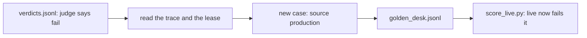

# Feed failures back

## The problem

The monitor found failures on the new template. Dana fixes the lease desk. Later, someone changes the prompt again. CI catches the old failure only if it is in the golden set. An alert that never becomes a test is a problem you find twice.



## Your challenge

Add at least 3 cases to `golden_desk.jsonl`, one JSON object per line. Take each from a production trace that failed. Tag it `"source": "production"`. At least one must be on the new template, FH-RES-2026.

For each case, read the trace and the lease. Then fill in:

- `gold_clauses`: the clause that answers the question, from the lease. Not the clause live cited.
- `must_say`: words from that clause that a right answer must contain.
- `critique`: one sentence on what the answer got wrong.

For example, trace `prod-5-12` asks for the rent of unit 1C at Rowan Steps. Live answered "No, the lease forbids it [L126-c02]." Run `uv run world lease L126` and you find the rent in clause c04: "Tenant shall pay monthly rent of $1,950.00". So the new case is:

```
{"id": "production-5-12", "source": "production", "trace_id": "prod-5-12", "lease_id": "L126", "question": "What is the monthly rent for unit 1C at Rowan Steps now?", "gold_clauses": ["L126-c04"], "must_say": "$1,950.00", "critique": "Asked for the rent, it answers about something else and cites clause c02."}
```

Pick `must_say` with care. For trace `prod-5-03`, the lease says "at least 60 days" and live says "Exactly 60 days". If `must_say` is only "60 days", the wrong answer passes. Use "at least 60 days".

Then score live on the golden set:

```bash
uv run python score_live.py
```

Expect: one `FAIL` line per new case, then `live fails 0 of 7 review cases` and `live fails 3 of 3 production cases` (or as many as you added).

That is what you want. The gate now blocks the live lease desk until a fix ships.

## Done when

- At least 3 cases are tagged `"source": "production"`, and the 7 review cases are still there.
- Each case names a real production trace, with its lease and question.
- `gold_clauses` and `must_say` come from the lease, not from the answer.
- Live fails each new case, and Dana's truth agrees the answer was wrong.
- At least one case is on the new template.

```bash
bun run verify feed-failures-back
```

Expect: `Done. All 9 rules pass.` and a `Progress:` line.

## If you get stuck

| What you see                                                 | Fix                                                                                      |
| ------------------------------------------------------------ | ---------------------------------------------------------------------------------------- |
| `FAIL gold_clauses are the clauses that answer the question` | Rent is in clause c04, and an extension is in c12. Live often cites c02, which is wrong. |
| `FAIL must_say is words from a gold clause ...`              | Copy the words from the lease, not from live's answer.                                   |
| `FAIL live fails every production case ...`                  | Pick a trace marked `fail` in `verdicts.jsonl`. A case live passes adds no new test.     |

The sample answer is in `../solution/golden_desk.jsonl`. Open it after you have tried.

## Words you will use

- **Golden set**: cases with known right answers that every release must pass.
- **Source tag**: a field that says where a case came from, such as `review` or `production`.
- **Regression**: a failure that was fixed once and comes back after a later change.
