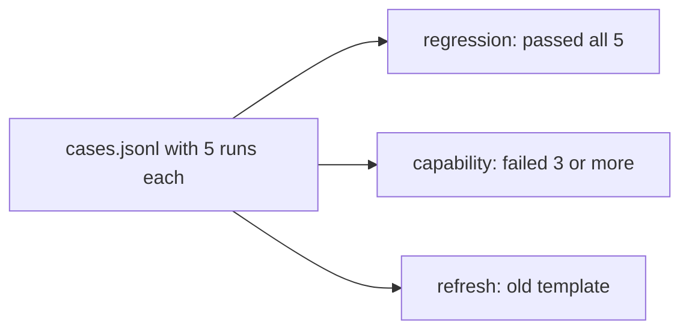

# Split the suites

## The problem

One pile of cases hides two jobs. Some cases guard what works today, and a failure there is a break. Others test what the system cannot do yet, and a failure there is normal. Mix them and a release that breaks nothing looks as bad as one that breaks a lot. Old cases also go stale: they were written on a template that production no longer uses.



## Your challenge

First, from the repo root: `cd parts/05-watch-production/04-split-the-suites/problem`.

Open `cases.jsonl`. Each line is one case. `history` holds its last five runs, newest last, with `P` for pass and `F` for fail. `template` is the lease template the case was written on. Production now uses `FH-RES-2026`.

For example, this case passed every run and is on an old template. It goes in regression, and in refresh as well:

```json
{ "id": "case-02", "history": "PPPPP", "template": "FH-RES-2019" }
```

Finish `split()` in `split_suites.py`. Put each case in the right list:

- **regression**: passed all five runs.
- **capability**: failed at least three of the five.
- **refresh**: not written on the current template.

A flaky case, such as `PPPFP`, is in neither of the first two. Watch it, and do not gate on it.

```bash
uv run python split_suites.py
```

Expect: `regression   6 cases`, `capability   5 cases`, `refresh      4 cases` and `Wrote suites.json`.

## Done when

- `regression` holds only cases that passed all five runs.
- `capability` holds the cases that failed at least three runs.
- `refresh` holds every case that is not on the current template.
- No case is in both regression and capability.

```bash
bun run verify split-the-suites
```

Expect: `Done. All 5 rules pass.` and a `Progress:` line.

## If you get stuck

| What you see                                                  | Fix                                                               |
| ------------------------------------------------------------- | ----------------------------------------------------------------- |
| `FAIL regression holds only the cases that passed all 5 runs` | Test the whole history string, not just the last letter.          |
| `FAIL refresh holds every case not on the current template`   | Compare the template, not the history, and include passing cases. |
| `NotImplementedError`                                         | Replace the `raise` line with your code.                          |

The sample answer is in `../solution/split_suites.py`. Open it after you have tried.

## Words you will use

- **Regression suite**: cases the system passes today. A failure means a change broke something.
- **Capability suite**: hard cases the system fails today. It shows how far you have to go.
- **Refresh**: replace old cases with new ones from current traffic, so the suite matches production.
