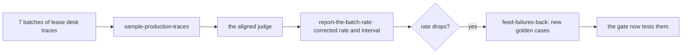

# Watch production

## The problem

The golden set covers the leases Fernhill had when it was built. Then 10 renewed leases arrive on a new template, FH-RES-2026, and staff start asking the lease desk about them. The CI gate cannot see a document it was never given. Only production traces show it.

## Why it matters

Anthropic's engineering team writes that automated evals are one of several views and that "a complete picture includes production monitoring, user feedback, A/B testing, manual transcript review, and systematic human evaluation" ([Demystifying evals for AI agents](https://www.anthropic.com/engineering/demystifying-evals-for-ai-agents), Anthropic). This part samples production traces in batches, judges them with the aligned judge, corrects the rate, and turns new failures into golden cases.

## Steps

| Step                       | Minutes | You produce                                                                | The check reads                                                                     |
| -------------------------- | ------- | -------------------------------------------------------------------------- | ----------------------------------------------------------------------------------- |
| `sample-production-traces` | 15      | a `monitor` command that samples each batch across buildings and judges it | its output on `world/data/traces/lease_desk_production.jsonl`, three runs in replay |
| `report-the-batch-rate`    | 15      | `batches.csv`: raw and corrected rate per batch, interval, alert           | rates recomputed; the alert fires on the new template batch and on no earlier batch |
| `feed-failures-back`       | 10      | 3 or more golden cases tagged `source: production`                         | the cases validate, and the gate now fails `live` on them                           |

## Walkthrough

TODO(part session): one command per step, each followed by its Expect: line.

## What you can show

A batch chart where the corrected grounded rate drops when the new template arrives, an alert that fired only there, and the golden set that now covers it.
