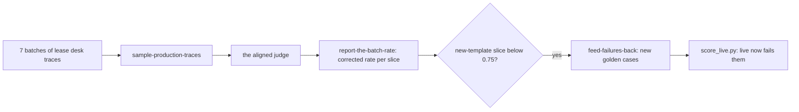

# Watch production

## The problem

The golden set covers the leases Fernhill had when you built it. Then 10 renewed leases arrive on a new template, FH-RES-2026. A template is the standard text a lease starts from. Staff start to ask the lease desk about these new leases. The CI gate cannot test a document it was never given. Only production traces, the records of real use, show what happens.

For example, look at trace `prod-5-12` in `world/data/traces/lease_desk_production.jsonl`. It is about lease L126, one of the new leases. Staff asked: "What is the monthly rent for unit 1C at Rowan Steps now?" The lease desk answered: "No, the lease forbids it [L126-c02]." The answer does not fit the question, and the clause it cites does not support it. Your golden set has no lease like L126, so no test there could catch this.

## Why it matters

Anthropic's engineering team writes that "production monitoring kicks in post-launch to detect distribution drift and unanticipated real-world failures". It also says that "a complete picture includes production monitoring, user feedback, A/B testing, manual transcript review, and systematic human evaluation". The source is [Demystifying evals for AI agents](https://www.anthropic.com/engineering/demystifying-evals-for-ai-agents), from Anthropic. Drift means the inputs change over time. A new lease template is drift.

In this part, you take a sample of production traces from each batch. You grade them with the judge you aligned with Dana in Judge what code cannot. You correct the rate for that judge's errors. Then you turn new failures into new golden cases.



## Steps

| Step                       | Minutes | You produce                                                                | The check reads                                                                            |
| -------------------------- | ------- | -------------------------------------------------------------------------- | ------------------------------------------------------------------------------------------ |
| `sample-production-traces` | 15      | `monitor.py`: a sample of each batch, graded by the aligned judge          | three runs of your monitor in replay, against the production traces                        |
| `report-the-batch-rate`    | 15      | `batches.csv`: raw and corrected rate per batch and slice, interval, alert | rates recomputed from `verdicts.jsonl`; the alert fires on batch 5 and on no earlier batch |
| `feed-failures-back`       | 10      | 3 or more golden cases tagged `source: production`                         | the cases match real failed traces and the lease, and live fails them                      |

Each step starts from the sample answer of the step before it. So you can start at any step.

## Walkthrough

Work in each step's `problem/` folder. From the repo root:

```bash
cd parts/05-watch-production/01-sample-production-traces/problem && uv run python monitor.py --seed 7 && cd -
```

Expect: `Graded 210 production traces:` and the path of `verdicts.jsonl`, once `sample_batch()` and `grade()` are written.

```bash
bun run verify sample-production-traces
```

Expect: `Done. All 8 rules pass.`

```bash
cd parts/05-watch-production/02-report-the-batch-rate/problem && uv run python report.py && cd -
```

Expect: a table with `ALERT` on the new-template rows of batches 5, 6 and 7, then `Wrote 10 rows to batches.csv`.

```bash
bun run verify report-the-batch-rate
```

Expect: `Done. All 7 rules pass.`

Add 3 production cases to `03-feed-failures-back/problem/golden_desk.jsonl`, then:

```bash
cd parts/05-watch-production/03-feed-failures-back/problem && uv run python score_live.py; cd -
```

Expect: `live fails 0 of 7 review cases`, then `live fails 3 of 3 production cases`, or as many as you added. The sample answer adds 4.

```bash
bun run verify part watch-production
```

Expect: `Part watch-production is done: 3/3 steps pass.`

## What you can show

You can show three things:

- `batches.csv`: the corrected grounded rate for each batch, with the new template as its own slice;
- an alert that fired when the new template arrived, and on no batch before it;
- a golden set that now holds production failures, which the live lease desk fails until a fix ships.

For example, batch 5's new-template row reads `5,new-template,16,0.5,0.475,0.133,0.807,yes`. The rate over all of batch 5 is 0.56, close to batch 4. Only the slice shows the problem.

## Finished

You now have a monitor that watches what CI cannot see. It samples every batch, grades it with a judge you trust, corrects the rate, and raises an alert on a new kind of input. Each failure it finds becomes a test. The next part, Evaluate retrieval and the agent, asks why the lease desk failed. Did the search miss the clause, or did the model misread it?

## Assignment

Hand in `monitor.py`, `batches.csv` and your `golden_desk.jsonl` with 3 or more production cases. Each question is yes or no:

1. Does `bun run verify part watch-production` pass?
2. Does `batches.csv` have a `new-template` row for each batch with new-template traces?
3. Does the alert fire on batch 5 and on no batch before it?
4. Is every production case a trace Dana's truth marks wrong, with `must_say` taken from the lease?

## Extension

Make the alert rule use the interval, not the point estimate. For example, alert only when `ci_high` is below 0.75. Show that it stops a false alarm on a small batch, and say what it costs you.
