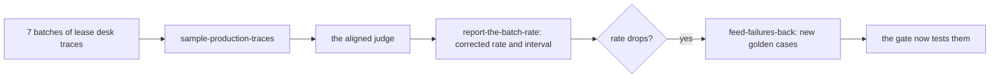

# Watch production

## The problem

The golden set covers the leases Fernhill had when you built it. Then 10 renewed leases arrive on a new template, FH-RES-2026. A template is the standard text a lease starts from. Staff start to ask the lease desk about these new leases. The CI gate cannot test a document it was never given. Only production traces, the records of real use, show what happens.

For example, look at trace `prod-5-12` in `world/data/traces/lease_desk_production.jsonl`. It is about lease L126, one of the new leases. Staff asked: "What is the monthly rent for unit 1C at Rowan Steps now?" The lease desk answered: "No, the lease forbids it [L126-c02]." The answer does not fit the question, and the clause it cites does not support it. Your golden set has no lease like L126, so no test there could catch this.

## Why it matters

Anthropic's engineering team writes that automated evals are one of several views. It says that "a complete picture includes production monitoring, user feedback, A/B testing, manual transcript review, and systematic human evaluation". The source is [Demystifying evals for AI agents](https://www.anthropic.com/engineering/demystifying-evals-for-ai-agents), from Anthropic.

In this part, you take a sample of production traces from each batch. You grade them with the judge you aligned with Dana in Judge what code cannot. You correct the rate for that judge's errors. Then you turn new failures into new golden cases.

## Steps

| Step                       | Minutes | You produce                                                                | The check reads                                                                     |
| -------------------------- | ------- | -------------------------------------------------------------------------- | ----------------------------------------------------------------------------------- |
| `sample-production-traces` | 15      | a `monitor` command that samples each batch across buildings and judges it | its output on `world/data/traces/lease_desk_production.jsonl`, three runs in replay |
| `report-the-batch-rate`    | 15      | `batches.csv`: raw and corrected rate per batch, interval, alert           | rates recomputed; the alert fires on the new template batch and on no earlier batch |
| `feed-failures-back`       | 10      | 3 or more golden cases tagged `source: production`                         | the cases validate, and the gate now fails `live` on them                           |

## Walkthrough

TODO(part session): one command per step, each followed by its Expect: line.

## What you can show

You can show three things:

- a chart of the corrected grounded rate for each batch, which drops when the new template arrives;
- an alert that fired only on that batch;
- a golden set that now covers the new template.
