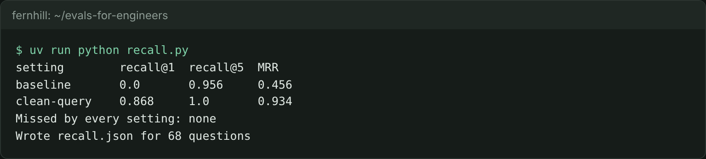

# Measure retrieval recall

## The problem

The lease desk answers from the 5 clauses its search finds. If the right clause is not among them, no prompt can save the answer. So before you blame the model, measure the search on its own.

Recall@k is the share of questions whose right clause is in the top k results. MRR (mean reciprocal rank) also rewards a right clause near the top: rank 1 scores 1, rank 2 scores 0.5, rank 5 scores 0.2. 68 of the 80 staff questions have a right clause. The other 12 have none, so they do not count here.



## Your challenge

1. In `retrieve.py`, finish `clean_query()` for the `clean-query` setting. The `baseline` setting is the finished keyword search. Leave it as it is.
2. In `recall.py`, finish `metrics()`: recall@1, recall@5 and MRR for one setting, and the questions it misses.

`retrieve.py` follows a contract, so the check can call it. It reads one JSON object per line, `{"lease_id", "query", "k"}`. It prints `{"clause_ids": [...]}`, best clause first.

For example, question `q001` asks: "How much notice does the tenant in unit 8D at Juniper Hall need to give to renew?" Its right clause is `L100-c12`. The baseline returns `L100-c02` first. That is the Premises clause, which names unit 8D at Juniper Hall, as the question does. The right clause comes second, so `q001` is a hit for recall@5 and a miss for recall@1.

```bash
echo '{"lease_id": "L100", "query": "How much notice does the tenant in unit 8D at Juniper Hall need to give to renew?", "k": 5}' | uv run python retrieve.py
```

Expect: `{"clause_ids": ["L100-c02", "L100-c12", "L100-c14", "L100-c13", "L100-c08"]}`

```bash
uv run python recall.py
```

Expect: one line per setting with recall@1, recall@5 and MRR, then `Wrote recall.json for 68 questions`.

## Done when

- `recall.json` has at least two settings, one of them `baseline`, and counts 68 questions.
- Its numbers match what your `retrieve.py` returns.
- One setting reaches recall@5 of 0.85 or more.
- Your own setting beats the baseline's MRR by 0.10 or more.
- `missed_by_every_setting` lists the questions no setting finds.

```bash
bun run verify measure-retrieval-recall
```

Expect: `Done. All 8 rules pass.` and a `Progress:` line.

## If you get stuck

| What you see                                         | Fix                                                                                             |
| ---------------------------------------------------- | ----------------------------------------------------------------------------------------------- |
| `FAIL your own setting beats the baseline's MRR ...` | Take the building name and `unit 8D` out of the query. Then look at the questions still missed. |
| `FAIL recall.json counts the 68 questions ...`       | Skip questions whose `gold` list is empty.                                                      |
| `FAIL recall@1, recall@5 and MRR match ...`          | Run `recall.py` again after every change to `retrieve.py`.                                      |

The sample answer is in `../solution/`. Open it after you have tried.

## Words you will use

- **Retrieval**: the search step that picks the clauses the model reads.
- **Recall@k**: the share of questions whose right clause is in the top k.
- **MRR**: the average of 1 / rank of the first right clause, with 0 when it is not found.
