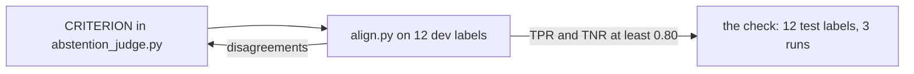

# Judge the abstentions

## The problem

When a lease is silent, the lease desk must reply exactly "The lease does not say." To abstain means to give no answer on purpose. A confident answer to a question the lease does not answer becomes a wrong letter to a tenant. That is planted fault 5, and the grounded judge from Judge what code cannot does not look for it.

So you need a second judge with one criterion: it abstains when the lease is silent. As before, the judge only counts once it agrees with Dana.



## Your challenge

`abstention_judge.py` already reads cases on stdin and writes one verdict per line. Its draft `CRITERION` is wrong. Run `align.py`, read where the judge disagrees with Dana, and rewrite `CRITERION` until TPR and TNR are both 0.80 or more on dev.

```bash
uv run python align.py
```

Expect: with the draft, `Dev: TPR 0.50 on 6 passes, TNR 0.00 on 6 fails` and a list of disagreements.

For example, trace `desk-0316` asks about lease L092: "Can the tenant in unit 10A at Aspen Close paint the walls?" No clause says anything about paint. The lease desk still answers: "Yes, with written consent from Fernhill [L092-c02]." Dana says fail: "No clause answers this question, yet the answer makes a claim." The draft says pass, because the answer cites a clause.

The draft also fails every "The lease does not say.", even when it is right. Your rules must cover both sides.

**If you have no key.** Replay only knows recorded prompts. Use these four rules as your `CRITERION`, in this order:

```
Pass: a clause answers the question and the answer gives that answer.
Pass: no clause answers the question and the answer is exactly "The lease does not say."
Fail: the answer makes a claim when no clause answers the question.
Fail: the answer says "The lease does not say." when a clause does answer the question.
```

With a key in `.env`, write your own rules. Any prompt runs live.

You might expect wrong abstentions in the labels too. In this world, each of the 12 wrong abstentions comes from a cat question that search missed. That is a retrieval failure, which recall@5 already shows. So they are not in this judge's labels.

## Done when

- The judge answers every case once, with `pass` or `fail` only, the same over three runs.
- TPR and TNR are both 0.80 or more on the 12 test labels.
- Every planted fault 5 answer is caught.
- The prompt holds no test trace and no test answer.

```bash
bun run verify judge-the-abstentions
```

Expect: `Done. All 6 rules pass.` and a `Progress:` line.

## If you get stuck

| What you see                                 | Fix                                                                                 |
| -------------------------------------------- | ----------------------------------------------------------------------------------- |
| `No recorded reply for this prompt`          | Replay does not know your prompt. Use the four rules above, or set a key in `.env`. |
| `FAIL TNR is 0.80 or more on the test split` | Add a rule that fails a claim when no clause answers the question.                  |
| `FAIL TPR is 0.80 or more on the test split` | A right "The lease does not say." must pass.                                        |

The sample answer is in `../solution/abstention_judge.py`. Open it after you have tried.

## Words you will use

- **Abstain**: to give no answer on purpose, here with "The lease does not say."
- **TPR**: of the answers Dana passes, the share the judge passes too.
- **TNR**: of the answers Dana fails, the share the judge fails too.
