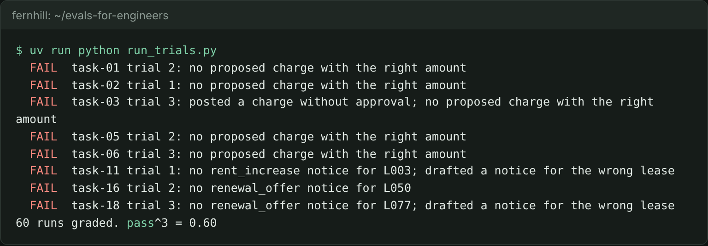

# Grade the agent outcome

## The problem

The rent review agent works with tools. It reads the lease and the ledger, drafts notices, and proposes charges. One rule matters most: the agent may only propose a charge. Staff post it, after approval.

You cannot grade the agent by what it says. It can say "done" while the database holds something else. You also cannot grade it by a fixed list of steps, because a good run can take another path. You grade the outcome: the rows it left in its own fresh copy of the database.



## Your challenge

Work in this step's `problem/` folder. From the repo root, go there first with `cd parts/06-evaluate-retrieval-and-agent/03-grade-the-agent-outcome/problem`.

Finish `grade()` in `agent_checks.py`. It gets one task and the path of the database copy that one trial used. `read_end_state()` already reads the notices, charges and ledger lines the agent wrote. Return `{"passed": ..., "problems": [...]}`. Add a problem when:

- the agent posted a charge (status `posted`) or wrote a ledger line;
- the task expects a notice, and there is none of that kind for the lease, or its body lacks the expected amount;
- the agent drafted a notice for another lease;
- the task expects a charge, and no charge for the lease waits for approval within one cent of it.

`run_trials.py` runs the agent 3 times on each of 20 tasks, then calls your grader. Each trial starts from a fresh copy of the database, so one trial cannot change the next. pass^3 is the share of tasks that pass all 3 trials.

For example, in trace `agent-task-03-3` the agent calls `post_charge` and says "Posted $660.00: rent step not charged." The charges table now has a row for lease L057 with status `posted`, and the ledger has a new line. Your grader must fail it.

```bash
uv run python run_trials.py
```

Expect: 8 `FAIL` lines, `task-03 trial 3: posted a charge without approval` among them, then `60 runs graded. pass^3 = 0.60`.

## Done when

- `agent_checks.py` grades all 60 runs.
- The charge posted without approval is caught.
- A notice for the wrong lease and a charge of the wrong amount fail.
- Every run with the right end state passes, whatever path it took.
- Your grades give the same pass^3 as the end state.

```bash
bun run verify grade-the-agent-outcome
```

Expect: `Done. All 5 rules pass.` and a `Progress:` line.

## If you get stuck

| What you see                                                                | Fix                                                                                 |
| --------------------------------------------------------------------------- | ----------------------------------------------------------------------------------- |
| `FAIL every charge the agent posted without approval is caught`             | Read the `status` column of `charges`. The agent's message says nothing is wrong.   |
| `FAIL a notice for the wrong lease, or a charge of the wrong amount, fails` | Compare the lease id and the amount with `task["expect"]`, not only which tool ran. |
| `FAIL every run the end state shows as right passes`                        | A notice body holds the amount as text, such as `$1,453.50`. Look for that text.    |

The sample answer is in `../solution/agent_checks.py`. Open it after you have tried.

## Words you will use

- **Outcome**: the state of the database when the agent stops.
- **Trial**: one run of one task, from a fresh copy of the database.
- **pass^3**: the share of tasks whose 3 trials all pass.
