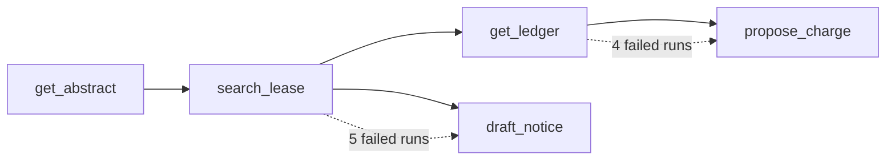

# Map agent failures

## The problem

pass^3 says how often the agent fails. It does not say where. A run has several steps, and the first wrong step is where a fix belongs. Later steps often fail only because an earlier one did.

A transition failure map counts, for every failed run, two states: the last one that went right, and the first one that went wrong. The biggest cell is your next fix.



## Your challenge

Work in this step's `problem/` folder. From the repo root, go there first with `cd parts/06-evaluate-retrieval-and-agent/04-map-agent-failures/problem`.

Finish `first_failure()` in `map_failures.py`. `PLAN` names the steps a good run takes for each kind of task. These are the state names everyone uses, so your map compares with anyone else's. Walk the plan and the run's steps side by side. A step is right when:

- its tool is the planned state, and the tool did not report an error;
- it acts on the task's lease;
- for `propose_charge`, the amount is within one cent of the expected charge.

The first planned state that is wrong, or never reached, is the first failure. Return `None` for a run with no wrong step. `map_failures.py` reads all 80 runs in `world/data/traces/agent.jsonl`, counts the cells and writes `transitions.csv` and `next_fix.txt`.

For example, run `agent-task-11-1` is a rent-step notice for lease L003. Its steps are `get_abstract` and `search_lease` on L003, both right. Then `draft_notice` names lease L004. So the last good state is `search_lease`, and the first failed state is `draft_notice`.

```bash
uv run python map_failures.py
```

Expect: 4 cells with `search_lease -> draft_notice 5` at the top, then `Next fix: search_lease -> draft_notice: 5 of 13 failed runs.`

A run that calls `post_charge` fails at `propose_charge`, the step it should have taken. That cell holds the most costly failure, but it is not the biggest. The map tells you what to fix first. The posted charge tells you what must never ship.

## Done when

- `transitions.csv` has the columns `last_good,first_failed,count` and uses the shared state names.
- The counts add up to the 13 failed runs, not to all 80.
- Every cell has the right count.
- `next_fix.txt` names the top cell.

```bash
bun run verify map-agent-failures
```

Expect: `Done. All 5 rules pass.` and a `Progress:` line.

## If you get stuck

| What you see                                            | Fix                                                                 |
| ------------------------------------------------------- | ------------------------------------------------------------------- |
| `FAIL the counts add up to the 13 runs that failed ...` | Return `None` when every planned step went right.                   |
| `FAIL every cell has the right count`                   | Check the lease id and the amount, not only the tool name.          |
| `FAIL every cell uses the shared state names`           | Name the planned state, never the tool the agent called by mistake. |

The sample answer is in `../solution/map_failures.py`. Open it after you have tried.

## Words you will use

- **State**: one planned step of a run, such as `search_lease`.
- **Transition failure map**: a count of failed runs by last good state and first failed state.
- **Next fix**: the cell with the most failed runs.
