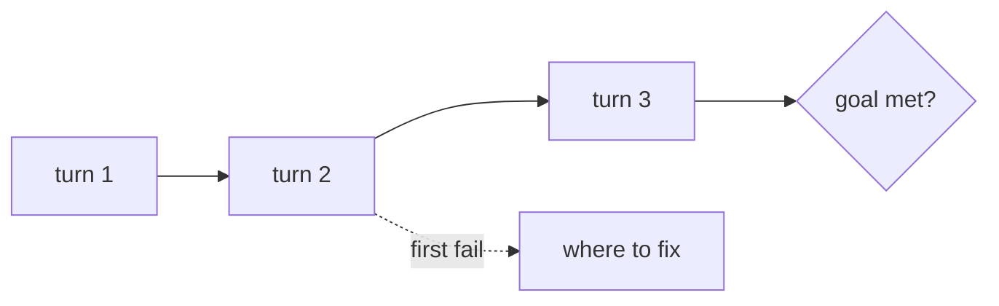

# Evaluate a multi-turn chat

## The problem

A tenant asks the lease desk about a late fee, then about a payment plan. Each reply can look fine on its own and the chat can still fail, because the tenant never got the plan. Scoring single replies hides this. Here 10 chats have 34 replies, and 79% of the replies are right, but only half the chats reach their goal.



## Your challenge

First, from the repo root: `cd parts/06-evaluate-retrieval-and-agent/05-evaluate-multi-turn/problem`.

Open `conversations.jsonl`. Each line is one chat. `turns` has one `true` or `false` per desk reply, from a judge. `goal_met` says whether the tenant got what they came for by the end.

For example, chat `c02` has one bad reply and still met its goal, so the desk recovered:

```json
{"id": "c02", "turns": [true, false, true], "goal_met": true}
```

Finish `summarise()` in `multi_turn.py`. Its docstring lists the five values to return.

```bash
uv run python multi_turn.py
```

Expect: `Goal met in 0.5 of conversations.` and `Wrote multi_turn.json`.

## Done when

- `goal_rate` counts chats, not replies.
- `all_turns_rate` counts chats where no reply failed.
- `per_turn_rate` counts single replies.
- `first_fail_turns` counts failing chats by the turn where each first broke.
- `recovered` lists the chats that missed a reply and still met the goal.

```bash
bun run verify evaluate-multi-turn
```

Expect: `Done. All 6 rules pass.` and a `Progress:` line.

## If you get stuck

| What you see                                                  | Fix                                                                 |
| ------------------------------------------------------------- | ------------------------------------------------------------------- |
| `FAIL goal_rate is the share of conversations that met...`    | Count `goal_met` per chat. Do not average the replies.              |
| `FAIL first_fail_turns counts conversations by the turn...`   | Count turns from 1, use string keys, and skip chats with no failure. |
| `NotImplementedError`                                         | Replace the `raise` line with your code.                            |

The sample answer is in `../solution/multi_turn.py`. Open it after you have tried.

## Words you will use

- **Turn**: one reply from the system in a chat.
- **Goal**: what the user came to get, checked at the end of the chat.
- **Recovered**: a chat that had a bad reply and still met its goal.
