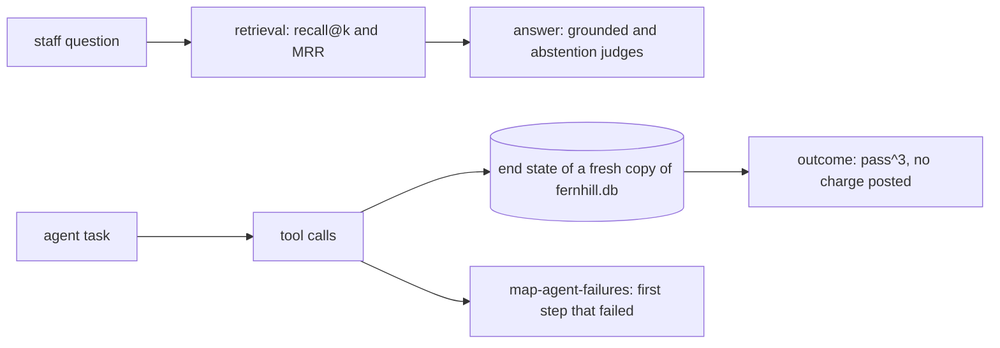

# Evaluate retrieval and the agent

## The problem

When the lease desk is wrong, there are two possible causes. The search may have missed the right clause, or the model may have misread it. When the rent review agent fails, you want to know which step broke first. You also want to know if it posted a charge that only staff may post. A single pass rate cannot tell you any of this.

For example, take question `q001` in `world/data/questions.jsonl`. The right clause for it is `L100-c12`. For trace `desk-0001`, the search returned `["L100-c02", "L100-c12", "L100-c14", "L100-c13", "L100-c08"]`. The right clause is second, not first. So it counts as a hit for recall@5, because the right clause is in the top 5. It is a miss for recall@1.

For the agent, take trace `agent-task-03-3` in `world/data/traces/agent.jsonl`. The agent should propose a charge for staff to approve. Instead, it called the `post_charge` tool and said "Posted $660.00: rent step not charged." The charge is now in the database, and no person approved it.

## Why it matters

Anthropic's engineering team defines the outcome of an agent run: "The outcome is the final state in the environment at the end of the trial." It gives an example: "A flight-booking agent might say 'Your flight has been booked'". The outcome is whether the booking really exists. So "it's often better to grade what the agent produced, not the path it took." It also gives a number for repeated trials. An agent that passes 75% of single trials passes all 3 of 3 trials only about 42% of the time, since 0.75 × 0.75 × 0.75 ≈ 0.42. The source is [Demystifying evals for AI agents](https://www.anthropic.com/engineering/demystifying-evals-for-ai-agents), from Anthropic.

A trial is one run of a task. In this part, pass^3 means that all 3 trials of a task pass.



## Steps

| Step                       | Minutes | You produce                                                   | The check reads                                                                              |
| -------------------------- | ------- | ------------------------------------------------------------- | -------------------------------------------------------------------------------------------- |
| `measure-retrieval-recall` | 20      | `retrieve.py` with two settings, and `recall.json`            | recall@1, recall@5 and MRR recomputed from your command on the 68 answerable questions       |
| `judge-the-abstentions`    | 20      | a second judge: abstains when the lease is silent             | three replay runs of your judge; TPR and TNR on its test split; every planted fault 5 caught |
| `grade-the-agent-outcome`  | 20      | `agent_checks.py`, which grades the end state of the database | your grades on 20 tasks by 3 replay trials, against the finished grader                      |
| `map-agent-failures`       | 20      | `transitions.csv` and `next_fix.txt`                          | counts recomputed from the 80 agent runs; the top cell named as the next fix                 |

The steps do not depend on each other's files. You can start at any step.

## Walkthrough

Work in each step's `problem/` folder. From the repo root:

```bash
cd parts/06-evaluate-retrieval-and-agent/01-measure-retrieval-recall/problem && uv run python recall.py && cd -
```

Expect: a line for `baseline` with recall@1 `0.0` and MRR `0.456`, a line for `clean-query`, and `Wrote recall.json for 68 questions`, once `clean_query()` and `metrics()` are written.

```bash
bun run verify measure-retrieval-recall
```

Expect: `Done. All 8 rules pass.`

```bash
cd parts/06-evaluate-retrieval-and-agent/02-judge-the-abstentions/problem && uv run python align.py && cd -
```

Expect: `Dev: TPR 0.83 on 6 passes, TNR 1.00 on 6 fails`, once `CRITERION` holds the aligned rules.

```bash
bun run verify judge-the-abstentions
```

Expect: `Done. All 6 rules pass.`

```bash
cd parts/06-evaluate-retrieval-and-agent/03-grade-the-agent-outcome/problem && uv run python run_trials.py && cd -
```

Expect: 8 `FAIL` lines and `60 runs graded. pass^3 = 0.60`, once `grade()` is written.

```bash
bun run verify grade-the-agent-outcome
```

Expect: `Done. All 5 rules pass.`

```bash
cd parts/06-evaluate-retrieval-and-agent/04-map-agent-failures/problem && uv run python map_failures.py && cd -
```

Expect: `Next fix: search_lease -> draft_notice: 5 of 13 failed runs.`, once `first_failure()` is written.

```bash
bun run verify part evaluate-retrieval-and-agent
```

Expect: `Part evaluate-retrieval-and-agent is done: 4/4 steps pass.`

## What you can show

You can show four things:

- recall@5 for the search, and the MRR your own setting gained over the baseline;
- an abstention judge that agrees with Dana, with TPR and TNR on held-out labels;
- pass^3 for the agent, and the one charge it posted without approval, found in the database and not in what the agent said;
- the transition map, with the next fix named.

For example, the baseline search puts the Premises clause first on every question, so its recall@1 is 0.0. Taking the unit and building out of the query lifts recall@1 to 0.868.

## Finished

You can now say why a system fails, not only how often. Search is measured apart from the answer. Each judge has one criterion and agrees with Dana. The agent is graded by the rows it leaves, and the map points at the first step to fix. This is the last part of the course. Your eval report now has a line for every system at Fernhill.

## Assignment

Hand in `retrieve.py` and `recall.json`, `abstention_judge.py`, `agent_checks.py`, and `transitions.csv` with `next_fix.txt`. Each question is yes or no:

1. Does `bun run verify part evaluate-retrieval-and-agent` pass?
2. Does one of your own retrieval settings beat the baseline's MRR by 0.10 or more?
3. Are the abstention judge's TPR and TNR both 0.80 or more on its test split?
4. Does your grader fail the run that posted a charge without approval?
5. Does `next_fix.txt` name the cell with the most failed runs?

## Extension

Run the eval-audit checklist from the ai-evals-course skills on your own repo. Write `audit.md` with at least three findings, ranked by impact, each naming a file.
