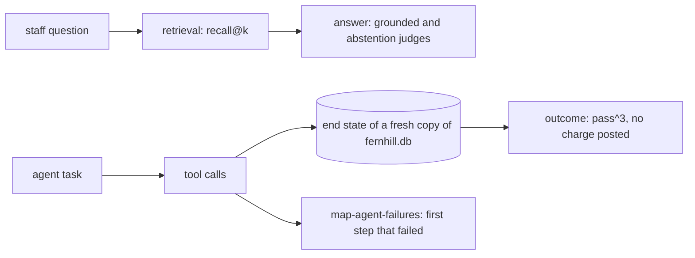

# Evaluate retrieval and the agent

## The problem

When the lease desk is wrong, was it the search that missed the clause, or the model that misread it? When the rent review agent fails, which step broke first? And did it post a charge that only staff may post? A single pass rate cannot say.

## Why it matters

Anthropic's engineering team defines the outcome of an agent run as "the final state in the environment", gives the example that "a flight-booking agent might say 'Your flight has been booked'" while the outcome is whether a reservation exists in the database, and advises that "it's often better to grade what the agent produced, not the path it took" ([Demystifying evals for AI agents](https://www.anthropic.com/engineering/demystifying-evals-for-ai-agents), Anthropic). It also warns that "a 0% pass rate across many trials (i.e. 0% pass@100) is most often a signal of a broken task".

## Steps

| Step | Minutes | You produce | The check reads |
|---|---|---|---|
| `measure-retrieval-recall` | 20 | a `retrieve` command and `recall.json` for at least two settings | recall@1, recall@5 and MRR recomputed from your command on the 80 questions |
| `judge-the-abstentions` | 20 | a second judge: abstains when the lease is silent | TPR and TNR on its test split, and every planted fault 5 answer caught |
| `grade-the-agent-outcome` | 20 | `agent_checks.py` that grades the end state of the database | your grades on 20 tasks over 3 replay trials, against the planted agent faults |
| `map-agent-failures` | 20 | `transitions.csv`: last good step against first failed step | counts recomputed from the 80 agent traces; the top cell named as the next fix |

## Walkthrough

TODO(part session): one command per step, each followed by its Expect: line.

## What you can show

recall@5 next to the answer judge, pass^3 for the agent, and the one charge it posted without approval, found in the database and not in what the agent said.
