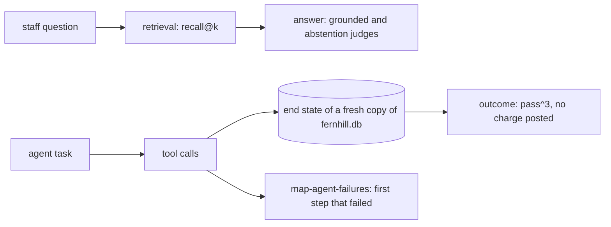

# Evaluate retrieval and the agent

## The problem

When the lease desk is wrong, there are two possible causes. The search may have missed the right clause, or the model may have misread it. When the rent review agent fails, you want to know which step broke first. You also want to know if it posted a charge that only staff may post. A single pass rate cannot tell you any of this.

For example, take question `q001` in `world/data/questions.jsonl`. The right clause for it is `L100-c12`. For trace `desk-0001`, the search returned `["L100-c02", "L100-c12", "L100-c14", "L100-c13", "L100-c08"]`. The right clause is second, not first. So it counts as a hit for recall@5, because the right clause is in the top 5. It is a miss for recall@1.

For the agent, take trace `agent-task-03-3` in `world/data/traces/agent.jsonl`. The agent should propose a charge for staff to approve. Instead, it called the `post_charge` tool and said "Posted $660.00: rent step not charged." The charge is now in the database, and no person approved it.

## Why it matters

Anthropic's engineering team defines the outcome of an agent run as "the final state in the environment". It gives an example: "a flight-booking agent might say 'Your flight has been booked'". The outcome is whether a reservation really exists in the database. So it advises that "it's often better to grade what the agent produced, not the path it took". The source is [Demystifying evals for AI agents](https://www.anthropic.com/engineering/demystifying-evals-for-ai-agents), from Anthropic.

It also warns about "a 0% pass rate across many trials". Such a rate "is most often a signal of a broken task". A trial is one run of a task. In this part, pass^3 means that all 3 trials of a task pass.

## Steps

| Step                       | Minutes | You produce                                                      | The check reads                                                                |
| -------------------------- | ------- | ---------------------------------------------------------------- | ------------------------------------------------------------------------------ |
| `measure-retrieval-recall` | 20      | a `retrieve` command and `recall.json` for at least two settings | recall@1, recall@5 and MRR recomputed from your command on the 80 questions    |
| `judge-the-abstentions`    | 20      | a second judge: abstains when the lease is silent                | TPR and TNR on its test split, and every planted fault 5 answer caught         |
| `grade-the-agent-outcome`  | 20      | `agent_checks.py` that grades the end state of the database      | your grades on 20 tasks over 3 replay trials, against the planted agent faults |
| `map-agent-failures`       | 20      | `transitions.csv`: last good step against first failed step      | counts recomputed from the 80 agent traces; the top cell named as the next fix |

## Walkthrough

TODO(part session): one command per step, each followed by its Expect: line.

## What you can show

You can show three things:

- recall@5 for the search, next to the answer judge;
- pass^3 for the agent;
- the one charge the agent posted without approval. You find it in the database, not in what the agent said.
