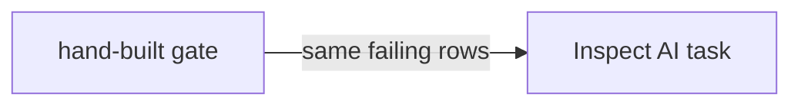

# Port the gate

## The problem

Your hand-built gate has a dataset, a call and a grader. Inspect AI runs the same three pieces as a dataset, a solver and a scorer. For example, the cheaper model fails the rent on leases such as L040, and Inspect must fail the same ones.



## Your challenge

Work in `assignment/`. Its `README.md` has the task. Fill in `assignment/task.py` and run it once:

```bash
uv run inspect eval assignment/task.py --model mockllm/model --log-dir assignment/logs
```

Expect: a score table with one mean per critical field.

Then check it:

```bash
bun run verify port-the-gate
```

Expect: `Done. All 3 rules pass.`

## Done when

- `inspect-ai` resolves to 0.3.289.
- An eval log has one score per dataset row.
- The failing rows match the hand-built gate.

## If you get stuck

Use `fernhill.evals.fields.score` as the scorer. Use `Epochs(3, "at_least_2")` so a lease passes when it is right in 2 of 3 trials. Read `solution/task.py` last.

## Words you will use

- **Sample:** one row of the dataset, here one lease.
- **Solver:** the step that produces an answer for a sample.
- **Scorer:** the step that grades the answer.
- **Epoch:** one more run of every sample.
