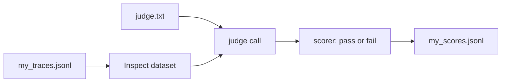

# Score your own traces

## The problem

So far the traces came from the course. The point of an eval is your own system. This step takes a handful of real traces from it, through to a judge that gives each one pass or fail. A shop's returns bot, for example, told a customer "we always refund postage". The policy says it does not. One judge line catches that answer, and Inspect AI runs it over every trace.



## Your challenge

First, from the repo root: `cd parts/07-score-the-answers-with-inspect-ai/02-score-your-own-traces/problem`.

1. Replace the two example rows in `my_traces.jsonl` with at least 10 real traces from your system. Each line has `id`, `input` and `output`. Use traces you can share, and remove names and secrets.
2. In `judge.txt`, write one criterion on the first line, starting with `Criterion:`. Below it, give the rules the judge checks against and ask for `pass` or `fail` on the first line of its reply.
3. Finish `my_task.py`. Load the traces with `json_dataset`. Read `judge.txt` into a `system_message`. Call `generate()`. Then write a scorer that gives a pass when the reply starts with `pass`.
4. Run it, then write one line per trace in `my_scores.jsonl`: `id`, `verdict` and a one sentence `reason`. Read each fail yourself.

```bash
uv run inspect eval my_task.py --model mockllm/model --log-dir logs
```

Expect: a score table with an accuracy. With the mock model every reply is the same, so the number means nothing yet. Swap in a real model to get a real one.

For example, one line in `my_scores.jsonl` looks like this:

```json
{
  "id": "t03",
  "verdict": "fail",
  "reason": "The answer promises something the shop policy does not say."
}
```

## Done when

- `my_traces.jsonl` has at least 10 of your own traces, not the course world.
- `judge.txt` names one criterion and asks for pass or fail.
- `my_task.py` loads the traces, uses `judge.txt` and scores the verdict.
- `my_scores.jsonl` has a verdict and a reason for every trace, with at least one pass and one fail.

```bash
bun run verify score-your-own-traces
```

Expect: `Done. All 6 rules pass.` and a `Progress:` line.

## If you get stuck

| What you see                                       | Fix                                                                     |
| -------------------------------------------------- | ----------------------------------------------------------------------- |
| `FAIL the traces are yours, not the course world`  | Remove lease ids and Fernhill text. Use traces from your own system.    |
| `FAIL judge.txt names one criterion ...`           | The first line must start with `Criterion:`. Remove every `TODO`.       |
| `FAIL the verdicts include both a pass and a fail` | Read the fails by hand. A judge that passes all of them is not working. |

The sample answer is in `../solution`. It uses a shop's returns bot, not Fernhill. Open it after you have tried.

## Words you will use

- **Trace**: one recorded run of your system, with its input and output.
- **Judge**: a model that reads an answer and gives pass or fail against one criterion.
- **Scorer**: the Inspect AI step that turns the judge's reply into a score.
