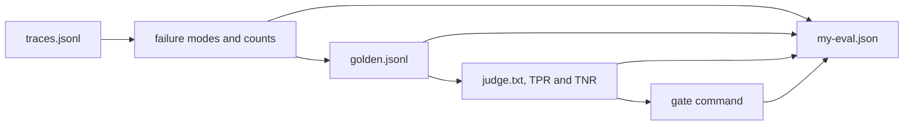

# Check your own work

## The problem

You have now built every piece on Fernhill. A course is only worth it if the same pieces run on your system. This step is the proof. You fill in one file, `my-eval.json`, with the facts of your own eval. The check reads that file and the files it points to. It does not read the course world, so it cannot pass on borrowed work.



## Your challenge

First, from the repo root: `cd parts/07-score-the-answers-with-inspect-ai/03-check-your-own-work/problem`.

Save these files in this folder, from your own system:

- `traces.jsonl`: at least 20 traces, one JSON object per line, each with an `id`.
- `golden.jsonl`: at least 20 cases a person approved.
- `judge.txt`: your judge prompt.

Then fill in `my-eval.json`. Replace every `TODO`. The pieces:

- `system` and `trace_count`: what you tested, and how many traces you have.
- `failure_modes`: 3 to 8. Each has a `name`, a one sentence `definition`, a `count`, and an `example_trace_id` from your traces.
- `golden_set`: the path and how many cases it holds.
- `judge`: the prompt path, how many labelled test answers you used, and the TPR and TNR you measured.
- `gate`: the command your CI runs, and what makes it fail.

For example, one failure mode looks like this:

```json
{"name": "wrong-refund-window", "definition": "The bot states a refund window that is not in the policy.", "count": 5, "example_trace_id": "s01"}
```

The check proves the shape and that the evidence exists. It cannot tell if the numbers are wise. Show the file to a colleague and ask them to open one example trace.

## Done when

- `my-eval.json` has no `TODO` left.
- The traces, the golden set and the judge prompt exist, and the counts match the files.
- Every failure mode has a real example trace, and the counts fit inside the trace count.
- Nothing comes from the course world.

```bash
bun run verify check-your-own-work
```

Expect: `Done. All 8 rules pass.` and a `Progress:` line.

## If you get stuck

| What you see                                              | Fix                                                                  |
| --------------------------------------------------------- | -------------------------------------------------------------------- |
| `FAIL traces_path points to at least 20 traces ...`       | Save the traces first, then set `trace_count` to the line count.     |
| `FAIL 3 to 8 failure modes, each with ... a real example` | The example id must be an `id` that appears in your traces file.     |
| `FAIL nothing comes from the course world`                | Remove Fernhill, lease ids and desk trace ids from your files.       |

The sample answer is in `../solution`. It tests an invented shop helper. Open it after you have tried.

## Words you will use

- **Failure mode**: a named, repeated way your system goes wrong.
- **TPR and TNR**: how often the judge passes good answers and fails bad ones.
- **Gate**: the check that blocks a change from shipping.
